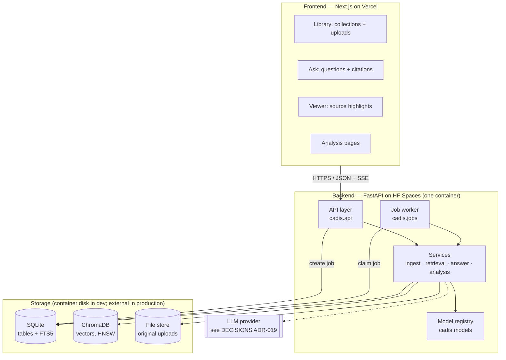
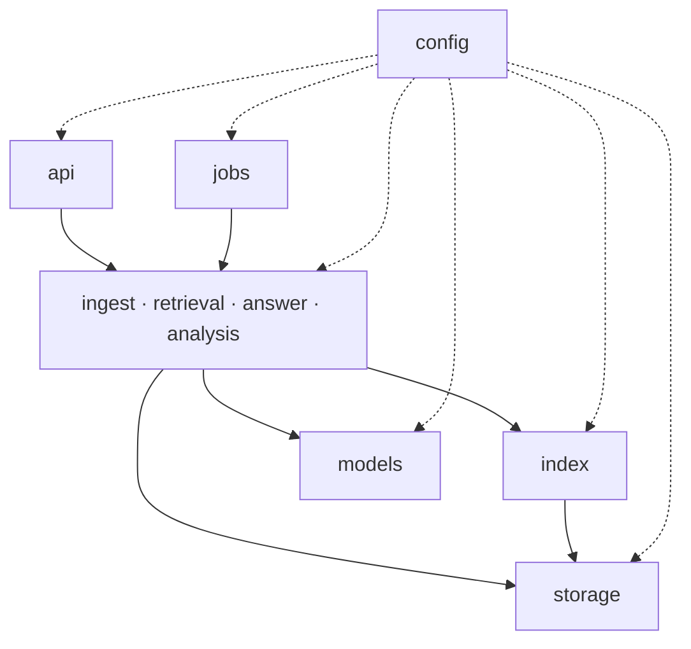
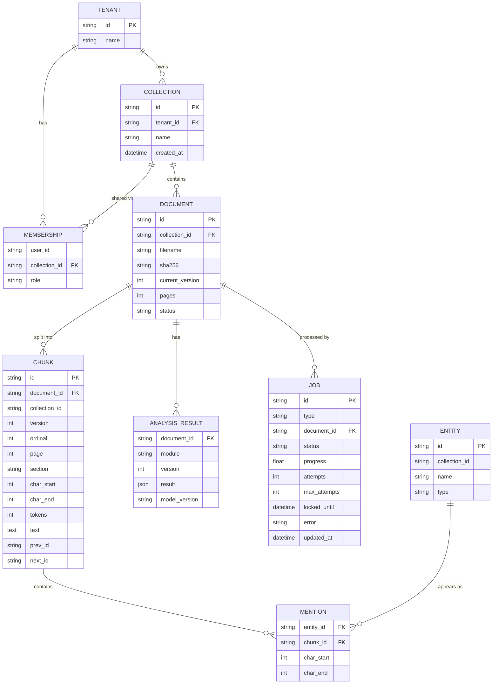
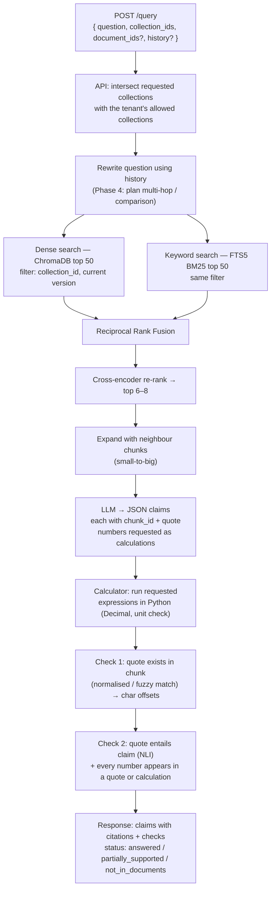
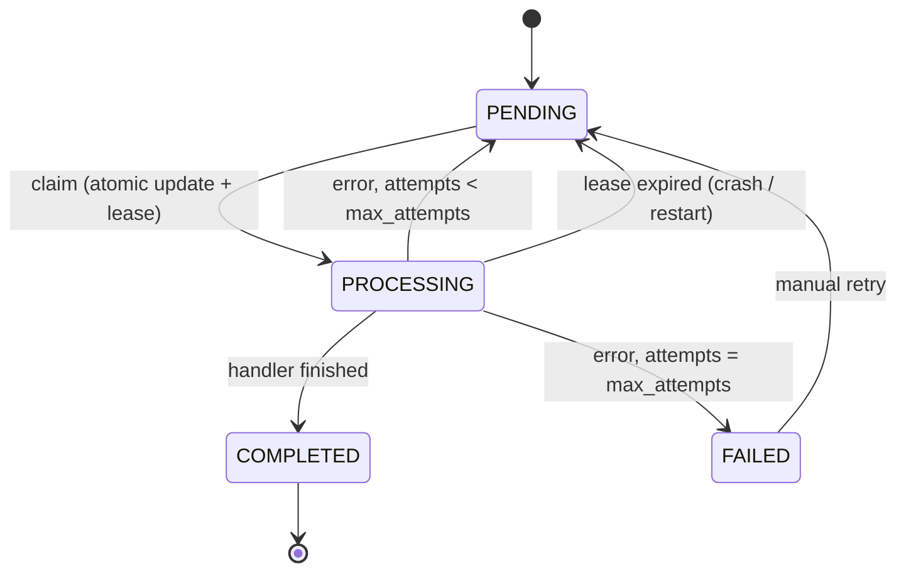
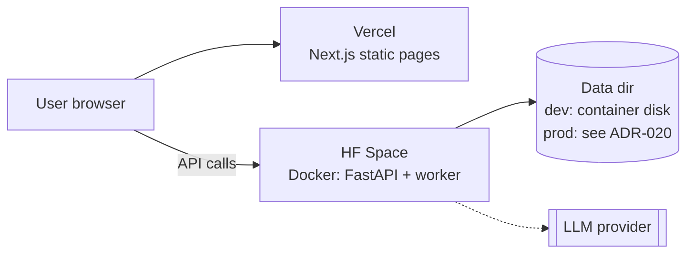

# CADIS V2 — Architecture

This document describes **how CADIS V2 is built**: its parts, how they talk to each other,
where the code lives, and how data moves through the system.

- **Why** each technology was chosen → [`DECISIONS.md`](DECISIONS.md)
- **What** gets built in which order → [`CADIS V2.md`](CADIS%20V2.md) (the phase plan)
- **What changed and when** → [`COMMIT_HISTORY.md`](COMMIT_HISTORY.md)

> **Status: target design.** As of 2026-11-10 the V1 code has been moved into
> `backend/cadis/` (Phase 0), but the API is still V1 (`/api/*` from `api/legacy.py`).
> Section [11](#11-implementation-status) tracks what exists. Update that table as parts
> are built; task-level progress is in [`CHECKLIST.md`](CHECKLIST.md).

---

## Contents

1. [V1 vs V2 at a glance](#1-v1-vs-v2-at-a-glance)
2. [System overview](#2-system-overview)
3. [Project structure](#3-project-structure)
4. [Layers and dependency rules](#4-layers-and-dependency-rules)
5. [Data model](#5-data-model)
6. [Flow: uploading a document](#6-flow-uploading-a-document)
7. [Flow: asking a question](#7-flow-asking-a-question)
8. [Background jobs](#8-background-jobs)
9. [API](#9-api)
10. [Configuration, models and deployment](#10-configuration-models-and-deployment)
11. [Implementation status](#11-implementation-status)
12. [Migrating from V1](#12-migrating-from-v1)

---

## 1. V1 vs V2 at a glance

| | V1 (today) | V2 (target) |
|---|---|---|
| Backend code | One file, `api_server.py` | Python package `backend/cadis/`, split by responsibility |
| Documents | Sent again with every request; never stored | Uploaded once, stored, referenced by ID |
| Scope | One document | Many documents in **collections**, owned by a **tenant** |
| Processing | One blocking request runs all 6 modules | Background jobs with progress; results stored |
| Search | Brute-force MiniLM cosine over 200-word passages | Hybrid: dense vectors (ChromaDB) + BM25 (SQLite FTS5) + RRF + cross-encoder re-rank |
| Answers | Extractive span (RoBERTa-SQuAD2) | Structured claims written by an LLM, each with citations, checked by quote match + entailment; arithmetic done in Python |
| Results in browser | Whole result in `localStorage` | Fetched from the API per document, per page |
| Storage | None | SQLite (metadata, chunks, jobs, FTS5) + ChromaDB (vectors) + file store |

---

## 2. System overview



**Key points**

- **Two deployables only:** the Next.js frontend and the FastAPI backend. No separate
  gateway (see DECISIONS ADR-001).
- The **API and the job worker run in the same container** at first, sharing the code and
  the model registry. They only coordinate through the **jobs table**, so the worker can
  later move to its own process or machine without code changes.
- **SQLite is the source of truth.** ChromaDB and FTS5 are *indexes* that can be rebuilt
  from the `chunk` table.

---

## 3. Project structure

Target layout. Files marked *(V1)* exist today; everything else is new.

```
CADIS/
├── backend/
│   ├── cadis/                          # the Python package (import name: cadis)
│   │   ├── __init__.py
│   │   ├── main.py                     # build FastAPI app: routers, CORS, startup/shutdown
│   │   ├── config.py                   # Settings (pydantic-settings), read from env / .env
│   │   │
│   │   ├── api/                        # HTTP only: parse request → call service → return response
│   │   │   ├── deps.py                 #   shared dependencies: db session, current tenant, allowed collections
│   │   │   ├── collections.py          #   /collections
│   │   │   ├── documents.py            #   /collections/{id}/documents, /documents/{id}
│   │   │   ├── jobs.py                 #   /jobs/{id}, /jobs/{id}/events (SSE)
│   │   │   ├── query.py                #   /query, /query/stream
│   │   │   ├── analysis.py             #   /documents/{id}/analysis/{module}
│   │   │   ├── legacy.py               #   V1 endpoints (/api/process, /api/qa-ask, /api/extract) during migration
│   │   │   └── schemas.py              #   Pydantic request/response models
│   │   │
│   │   ├── ingest/                     # file → clean text → chunks
│   │   │   ├── parsers.py              #   PDF / DOCX / TXT → pages of text + headings
│   │   │   ├── cleaning.py             #   headers/footers, hyphenation, line joins
│   │   │   ├── chunking.py             #   token-based, structure-aware chunks; deterministic IDs
│   │   │   └── pipeline.py             #   the ingest job: parse → clean → chunk → store → index
│   │   │
│   │   ├── index/                      # search indexes (rebuildable from the chunk table)
│   │   │   ├── vector_store.py         #   VectorStore interface + ChromaDB implementation
│   │   │   ├── exact.py                #   brute-force NumPy search (baseline / tests)
│   │   │   └── keyword_store.py        #   KeywordStore interface + SQLite FTS5 implementation
│   │   │
│   │   ├── retrieval/
│   │   │   ├── hybrid.py               #   dense + BM25 → Reciprocal Rank Fusion
│   │   │   ├── rerank.py               #   cross-encoder re-ranking
│   │   │   ├── expand.py               #   small-to-big: add neighbour chunks
│   │   │   └── planner.py              #   query rewrite, multi-hop split, comparison routing (Phase 4)
│   │   │
│   │   ├── answer/
│   │   │   ├── extractive.py           #   V1 RoBERTa span code (moved from api_server.py)
│   │   │   ├── generative.py           #   LLM → structured claims (JSON, validated)
│   │   │   ├── llm.py                  #   LLMClient interface + provider implementations
│   │   │   ├── calculator.py           #   safe ast-based arithmetic with Decimal + unit checks
│   │   │   └── verify.py               #   Check 1: quote exists · Check 2: entailment + number rule
│   │   │
│   │   ├── analysis/                   # the six "teaching" modules, run per document
│   │   │   ├── preprocessing.py
│   │   │   ├── embeddings_view.py      #   PCA projection, top pairs (no n×n matrix)
│   │   │   ├── ner.py                  #   chunked NER + entity linking
│   │   │   ├── coref.py                #   replaces ambiguity.py (Phase 5)
│   │   │   ├── ambiguity.py            #   V1 heuristic, kept until coref lands
│   │   │   └── summary.py              #   V1 map-reduce summarizer, run once per document
│   │   │
│   │   ├── models/
│   │   │   └── registry.py             #   lazy, cached model loading; one place to see RAM use
│   │   │
│   │   ├── storage/
│   │   │   ├── db.py                   #   SQLAlchemy engine/session, SQLite pragmas (WAL, FKs)
│   │   │   ├── tables.py               #   ORM tables (section 5)
│   │   │   ├── repositories.py         #   all queries; every content query takes allowed collection IDs
│   │   │   └── files.py                #   save/read original uploads by sha256
│   │   │
│   │   └── jobs/
│   │       ├── states.py               #   PENDING / PROCESSING / COMPLETED / FAILED + allowed moves
│   │       ├── queue.py                #   claim (atomic), heartbeat, complete, fail, recover
│   │       └── worker.py               #   loop: claim job → run handler → update state
│   │
│   ├── migrations/                     # Alembic migration scripts
│   ├── tests/
│   │   ├── unit/                       #   fast, no real models (fakes)
│   │   ├── integration/                #   real SQLite/Chroma in a temp dir
│   │   └── slow/                       #   real models; skipped by default (pytest -m slow)
│   └── scripts/
│       ├── benchmark.py                #   (V1, moved) cold vs warm latency
│       ├── eval.py                     #   retrieval + answer quality on data/eval
│       └── check_consistency.py        #   SQLite chunk IDs vs ChromaDB vs FTS5
│
├── client/                             # (V1) Next.js frontend
│   ├── app/
│   │   ├── page.tsx                    #   (V1) landing page
│   │   ├── launch/                     #   (V1) single-document upload → becomes "quick try"
│   │   ├── library/                    #   collections + document list + upload progress
│   │   ├── ask/                        #   question box, answers with claims + citations
│   │   ├── documents/[id]/             #   viewer with highlights + per-document analysis tabs
│   │   └── pipeline/                   #   (V1) six module pages → read from API instead of localStorage
│   ├── components/                     #   (V1) landing sections + shadcn/ui
│   └── lib/
│       ├── utils.ts                    #   (V1) cn() helper
│       └── api.ts                      #   typed API client (one place for the base URL)
│
├── data/
│   ├── ambiguity_dataset.csv           # (V1)
│   └── eval/                           # evaluation documents + questions (Phase 0)
│
├── api_server.py                       # (V1) becomes a 3-line shim: `from cadis.main import app`
├── Dockerfile                          # (V1) updated to copy backend/ and run cadis.main:app
├── requirements.txt                    # (V1)
├── README.md · CADIS V2.md · ARCHITECTURE_V2.md · DECISIONS.md · COMMIT_HISTORY.md
└── hf_README.md                        # (V1) HF Space card
```

---

## 4. Layers and dependency rules



Rules (enforce in code review; can be checked with `import-linter` later):

1. **Arrows point one way.** `api` may import services; services never import `api`.
   `storage` and `index` never import services.
2. **The API layer holds no NLP logic.** It validates input, resolves the tenant and allowed
   collections, calls one service function, and shapes the response.
3. **Every function that reads document content takes `allowed_collection_ids`.** There
   is no default of "all". This is how tenant isolation is guaranteed
   (DECISIONS ADR-015).
4. **Models are only loaded through `models/registry.py`.** No module calls
   `from_pretrained` directly. This keeps memory use visible and makes tests able to swap in
   fakes.
5. **External systems sit behind interfaces** (`VectorStore`, `KeywordStore`, `LLMClient`).
   Switching ChromaDB → pgvector or one LLM provider → another changes one file.
6. **Settings come only from `config.py`.** No `os.getenv` elsewhere.

---

## 5. Data model



Notes:

- **IDs are strings** (UUIDs for documents/collections/jobs). **Chunk IDs are
  deterministic**: `sha1(document_id : version : ordinal)`. Re-running ingestion produces
  the same IDs, so writes overwrite instead of duplicating (ADR-014).
- **`collection_id` is stored on `CHUNK` and `ENTITY` too**, even though it could be
  joined through `DOCUMENT`. Search filters need it directly, and ChromaDB metadata
  cannot join.
- **Versions:** a re-upload or re-ingest writes chunks with `version = current_version + 1`,
  then flips `DOCUMENT.current_version`, then deletes the old version. Every search filters
  on the current version.
- **FTS5 table:** `chunk_fts(chunk_id UNINDEXED, collection_id UNINDEXED, text)`, kept in
  sync with `CHUNK` by the ingest pipeline (upsert by `chunk_id`).
- **ChromaDB:** one collection named `chunks`, vector ID = chunk ID, metadata =
  `{document_id, collection_id, version, page}`.
- **File store:** originals saved as `files/<sha256>` so duplicate uploads are detected and
  ingestion can be re-run from the original.

---

## 6. Flow: uploading a document

```mermaid
sequenceDiagram
    autonumber
    participant UI as Frontend
    participant API as API (documents.py)
    participant DB as SQLite
    participant FS as File store
    participant W as Worker
    participant V as ChromaDB

    UI->>API: POST /collections/{id}/documents (files)
    API->>API: check tenant may write to collection; size/type limits
    API->>FS: save original as files/<sha256>
    API->>DB: insert DOCUMENT (status=PENDING) + JOB (PENDING)
    API-->>UI: 202 { document_id, job_id }
    UI->>API: GET /jobs/{id}/events (SSE)
    W->>DB: claim job (PENDING→PROCESSING, set lease)
    W->>FS: read original
    W->>W: parse → clean → chunk (deterministic IDs, version n+1)
    W->>DB: upsert CHUNK rows + FTS5 rows (progress 40%)
    W->>V: upsert vectors (progress 80%)
    W->>DB: flip current_version; delete old version (DB, FTS5, Chroma)
    W->>DB: JOB → COMPLETED (last step); DOCUMENT status=READY
    API-->>UI: progress events … completed
    Note over W,DB: Analysis modules (NER, summary, coref) run as<br/>separate jobs after ingest completes.
```

If the worker dies at any step, the job's lease expires, the job returns to `PENDING`,
and the whole job runs again. Because every write is an upsert keyed by deterministic
IDs, the second run produces the same final state (section 8).

---

## 7. Flow: asking a question



**Extractive mode** (V1 behaviour, kept as an option) replaces the three `GEN → V2` steps
with the RoBERTa span finder over the re-ranked chunks.

---

## 8. Background jobs

The database is the source of truth for job state. Execution starts as an in-process
worker and can move to RQ/Celery later without changing states or the API (ADR-013).



| Operation | How |
|---|---|
| **Claim** | `UPDATE job SET status='PROCESSING', locked_until=now+10min, attempts=attempts+1 WHERE id=(SELECT id FROM job WHERE status='PENDING' ORDER BY created_at LIMIT 1) AND status='PENDING'` — if 0 rows changed, another worker got it |
| **Heartbeat** | Every ~30 s while running: extend `locked_until`, write `progress` |
| **Recover** | At startup and every minute: `PROCESSING` jobs with `locked_until < now` → `PENDING` |
| **Fail** | Save `error`; back to `PENDING` if `attempts < max_attempts`, else `FAILED` |
| **Idempotency** | Handlers only upsert by deterministic IDs; `COMPLETED` is written last |
| **Consistency** | `scripts/check_consistency.py` compares chunk IDs in SQLite, FTS5 and ChromaDB, and repairs from SQLite |

SQLite settings for this to work with an API and a worker in parallel: WAL journal mode,
`busy_timeout`, foreign keys on, short transactions.

---

## 9. API

| Method & path | Body / params | Returns |
|---|---|---|
| `GET /health` | — | status, version, loaded models |
| `POST /collections` · `GET /collections` | `{ name }` | collection(s) visible to the tenant |
| `POST /collections/{id}/documents` | multipart files | `202` + `[{ document_id, job_id }]` |
| `GET /documents/{id}` · `DELETE /documents/{id}` | — | document info · deletes chunks, vectors, FTS rows, results |
| `GET /jobs/{id}` · `GET /jobs/{id}/events` | — | job state · SSE stream of progress |
| `GET /documents/{id}/analysis/{module}` | `?page=&page_size=` | stored module result, paginated |
| `POST /query` | `{ question, collection_ids, document_ids?, history?, mode? }` | structured claims (below) |
| `POST /query/stream` | same | SSE: one event per verified claim, then a final summary event |
| **Legacy** `POST /api/extract` · `/api/process` · `/api/qa-ask` | V1 bodies | V1 responses, until the frontend migration is done |

Query response:

```json
{
  "status": "answered",
  "answer_text": "125 + 275 = 400 units were sold [1][2].",
  "claims": [
    {
      "text": "400 units were sold in total.",
      "citations": [
        { "document_id": "d1", "chunk_id": "c1", "page": 3, "quote": "125 units sold", "char_start": 210, "char_end": 224 },
        { "document_id": "d2", "chunk_id": "c9", "page": 1, "quote": "275 units sold", "char_start": 88, "char_end": 102 }
      ],
      "calculation": { "expression": "a + b", "inputs": { "a": 125, "b": 275 }, "unit": "units", "result": "400" },
      "checks": { "quote_found": true, "supported": "entailed", "support_score": 0.97 }
    }
  ],
  "used_chunks": ["c1", "c9", "c4"],
  "timings_ms": { "search": 85, "rerank": 410, "generate": 2300, "verify": 350 }
}
```

Errors use FastAPI's standard `{ "detail": … }` with proper status codes (V1's `200` +
`{"error": …}` for empty documents is not repeated).

---

## 10. Configuration, models and deployment

### Settings (`cadis/config.py`)

All settings are environment variables with a `CADIS_` prefix (a `.env` file works in
development). Examples:

| Setting | Default | Meaning |
|---|---|---|
| `CADIS_DATA_DIR` | `./var` | SQLite file, ChromaDB folder, file store |
| `CADIS_DATABASE_URL` | `sqlite:///./var/cadis.db` | swap to Postgres later |
| `CADIS_FRONTEND_URLS` | `http://localhost:3000` | CORS allow-list (replaces `FRONTEND_URL`) |
| `CADIS_EMB_MODEL` / `CADIS_RERANK_MODEL` / `CADIS_NLI_MODEL` / `CADIS_QA_MODEL` / `CADIS_SUM_MODEL` / `CADIS_NER_MODEL` | see DECISIONS | model IDs |
| `CADIS_LLM_PROVIDER` / `CADIS_LLM_MODEL` / `CADIS_LLM_API_KEY` | unset | generative answers disabled when unset → extractive mode |
| `CADIS_CHUNK_TOKENS` / `CADIS_CHUNK_OVERLAP` | `384` / `48` | chunking; chunk + header must fit the embedding model (≤ 256 tokens for MiniLM, ≤ 512 for BGE — ADR-011). Startup fails if it does not. |
| `CADIS_RETRIEVE_K` / `CADIS_RERANK_K` | `50` / `8` | retrieval sizes |
| `CADIS_MAX_UPLOAD_MB` | `25` | upload limit |

V1 variable names (`QA_MODEL`, `SUM_MODEL`, `NER_MODEL`, `EMB_MODEL`, `FRONTEND_URL`) stay
supported as fallbacks until the migration is complete.

### Models in memory

The registry loads each model on first use and keeps it (like V1's `lru_cache`), and
`/health` lists what is loaded. Approximate disk sizes measured on the V1 models: RoBERTa
QA 475 MB, BERT NER 414 MB, MiniLM 90 MB, DistilBART 1.15 GB. New V2 models (embedding,
cross-encoder, NLI, coref) must be measured when added, and the total must fit the Space's
RAM with headroom. Record each addition in DECISIONS.

### Deployment



- The Dockerfile keeps V1's lessons: **CPU-only torch installed first**, **no model
  pre-download** in the image (it broke the HF build timeout), spaCy model baked in.
- **Container disk on HF Spaces is not persistent** by default. Until ADR-020 is decided,
  the deployed V2 is a demo whose data can disappear on restart.

---

## 11. Implementation status

Update this table in the same commit that changes the status.

| Component | Phase | Status |
|---|---|---|
| Package split (`backend/cadis/`), `api_server.py` shim | 0 | Done (`9a4f57c`) |
| `config.py` (pydantic-settings) | 0 | Done (`9a4f57c`) |
| Tests (unit / integration / slow) + CI | 0 | Unit + slow tests done (`2008457`); CI workflow added (`a91a548`), first run pending push; integration tier comes with Phase 1 |
| Evaluation set + `eval.py` | 0 | Partial (`bf1b85a`): `eval.py` + baseline done; set has 4 documents (target 5–10) and unbalanced question types |
| V1 fixes: chunked NER, MiniLM 256-token cap, cached passage embeddings, no n×n matrix, PCA plot | 0 | Done (`9a4f57c`) |
| Storage: SQLAlchemy tables + Alembic, file store | 1 | Not started |
| Tenancy: default tenant, `collection_id` everywhere, required filters, isolation test | 1 | Not started |
| Job queue: states, claim/lease/recover, worker | 1 | Not started |
| Ingest: parsers, cleaning, chunking, idempotent indexing | 1 | Not started |
| New API: collections, documents, jobs | 1 | Not started |
| Vector store (ChromaDB) + exact baseline | 2 | Not started |
| Keyword store (FTS5) + hybrid RRF | 2 | Not started |
| Cross-encoder re-rank | 2 | Not started |
| LLM client + structured claims | 3 | Not started |
| Calculator | 3 | Not started |
| Verification (quote + NLI + number rule) | 3 | Not started |
| Query planner (rewrite, multi-hop, comparison) | 4 | Not started |
| Analysis rework (stored results, coref, chunked NER, PCA) | 5 | Not started |
| Production storage, ONNX, auth, limits, monitoring | 6 | Not started |
| Frontend: library, ask, viewer, API-backed module pages | 1–5 | Not started |

---

## 12. Migrating from V1

The move is gradual (a "strangler" migration): the V1 app keeps working the whole time.

1. **Move code, change nothing.** Create `backend/cadis/`, move V1 functions into their
   modules (`answer/extractive.py`, `analysis/summary.py`, …), expose the same three V1
   endpoints from `api/legacy.py`. `api_server.py` becomes `from cadis.main import app`,
   so the Dockerfile, `benchmark.py` and the frontend keep working. Tests prove the V1
   responses are unchanged.
2. **Add V2 endpoints next to V1.** Collections, documents, jobs, query — new paths, no
   conflict with `/api/*`.
3. **Move the frontend page by page** to the V2 endpoints. `/launch` can stay as a
   "quick try" that uploads into a temporary collection.
4. **Remove V1 endpoints** once no page calls them, and remove the `api_server.py` shim
   when the Dockerfile points at `cadis.main:app`.
