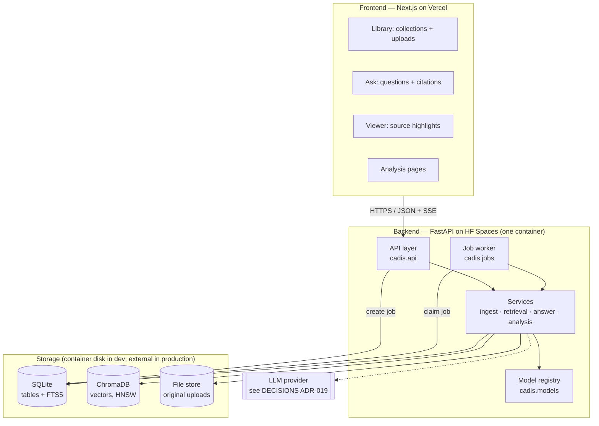
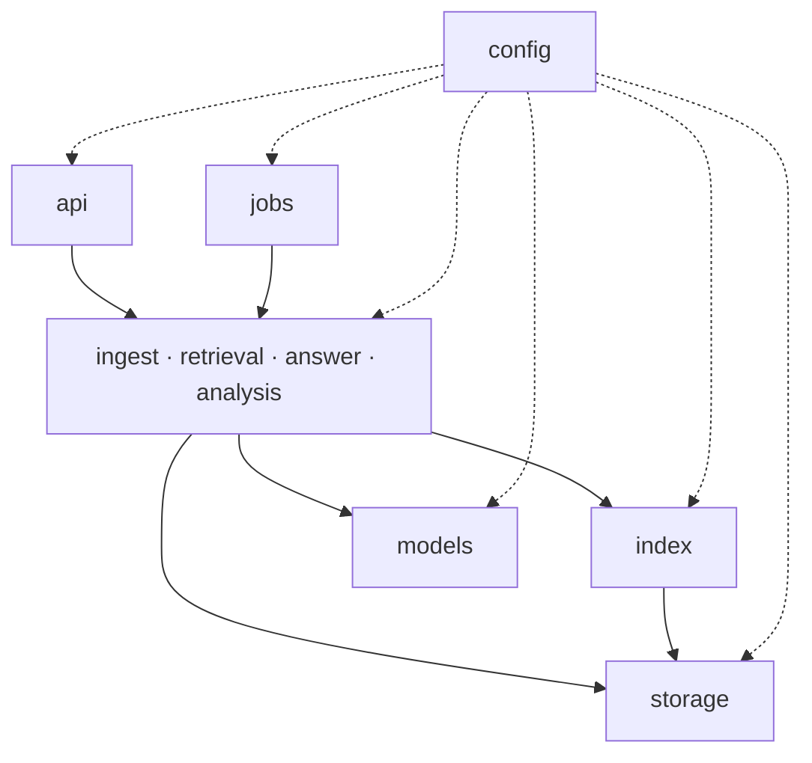
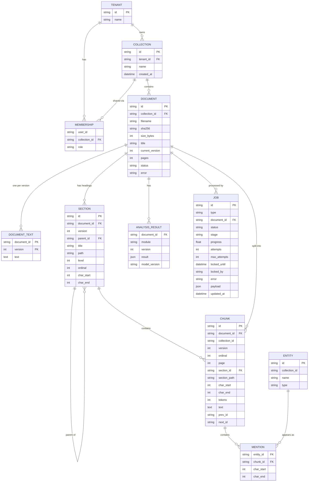
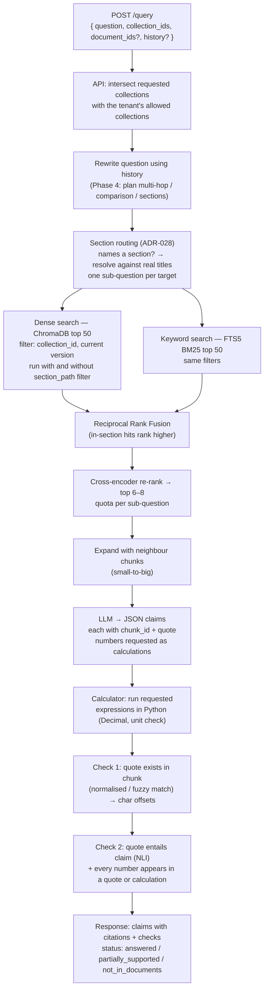
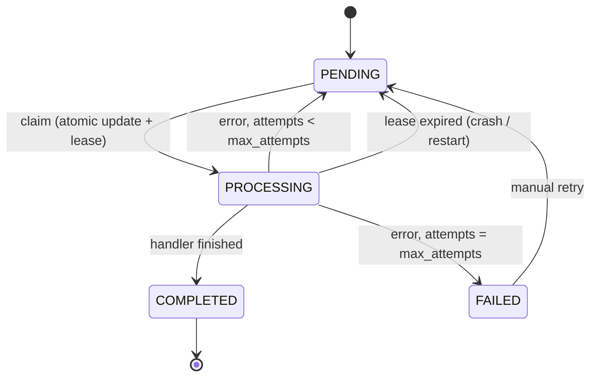
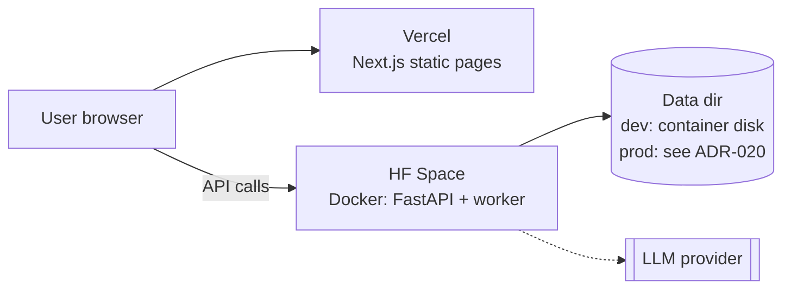

# CADIS V2 — Architecture

This document describes **how CADIS V2 is built**: its parts, how they talk to each other,
where the code lives, and how data moves through the system.

- **Why** each technology was chosen → [`DECISIONS.md`](DECISIONS.md)
- **What** gets built in which order → [`CADIS V2.md`](CADIS%20V2.md) (the phase plan)
- **What changed and when** → [`COMMIT_HISTORY.md`](COMMIT_HISTORY.md)

> **Status: partly built.** As of 2026-11-10, Phases 0–2 are done: the V1 code lives in
> `backend/cadis/`; V2 storage, ingestion, background jobs, the collections / documents /
> jobs API and retrieval (hybrid + re-rank + section filter, `POST /search`, extractive
> `POST /query`) run next to the V1 endpoints (`/api/*` from `api/legacy.py`).
> Generated answers (Phase 3) and the query planner (Phase 4) are not built yet.
> Section [11](#11-implementation-status) tracks what exists. Update that table as parts
> are built; task-level progress is in [`CHECKLIST.md`](CHECKLIST.md).

---

## Contents

1. [V1 vs V2 at a glance](#1-v1-vs-v2-at-a-glance)
2. [System overview](#2-system-overview)
3. [Project structure](#3-project-structure)
4. [Layers and dependency rules](#4-layers-and-dependency-rules)
5. [Data model](#5-data-model)
6. [Flow: uploading a document](#6-flow-uploading-a-document)
7. [Flow: asking a question](#7-flow-asking-a-question)
8. [Background jobs](#8-background-jobs)
9. [API](#9-api)
10. [Configuration, models and deployment](#10-configuration-models-and-deployment)
11. [Implementation status](#11-implementation-status)
12. [Migrating from V1](#12-migrating-from-v1)

---

## 1. V1 vs V2 at a glance

| | V1 (today) | V2 (target) |
|---|---|---|
| Backend code | One file, `api_server.py` | Python package `backend/cadis/`, split by responsibility |
| Documents | Sent again with every request; never stored | Uploaded once, stored, referenced by ID |
| Scope | One document | Many documents in **collections**, owned by a **tenant** |
| Processing | One blocking request runs all 6 modules | Background jobs with progress; results stored |
| Chunks | Fixed-size passages that ignore headings | Section-aware chunks that never cross a heading; each knows its section path |
| Search | Brute-force MiniLM cosine over 200-word passages | Hybrid: dense vectors (ChromaDB) + BM25 (SQLite FTS5) + RRF + cross-encoder re-rank, with a soft section filter when a question names a section |
| Answers | Extractive span (RoBERTa-SQuAD2) | Structured claims written by an LLM, each with citations, checked by quote match + entailment; arithmetic done in Python |
| Results in browser | Whole result in `localStorage` | Fetched from the API per document, per page |
| Storage | None | SQLite (metadata, chunks, jobs, FTS5) + ChromaDB (vectors) + file store |

---

## 2. System overview



**Key points**

- **Two deployables only:** the Next.js frontend and the FastAPI backend. No separate
  gateway (see DECISIONS ADR-001).
- The **API and the job worker run in the same container** at first, sharing the code and
  the model registry. They only coordinate through the **jobs table**, so the worker can
  later move to its own process or machine without code changes.
- **SQLite is the source of truth.** ChromaDB and FTS5 are *indexes* that can be rebuilt
  from the `chunk` table.

---

## 3. Project structure

Target layout. Files marked *(V1)* exist today; everything else is new.

```
CADIS/
├── backend/
│   ├── cadis/                          # the Python package (import name: cadis)
│   │   ├── __init__.py
│   │   ├── main.py                     # build FastAPI app: routers, CORS, startup/shutdown
│   │   ├── config.py                   # Settings (pydantic-settings), read from env / .env
│   │   │
│   │   ├── api/                        # HTTP only: parse request → call service → return response
│   │   │   ├── deps.py                 #   shared dependencies: db session, current tenant, allowed collections
│   │   │   ├── collections.py          #   /collections
│   │   │   ├── documents.py            #   /collections/{id}/documents, /documents/{id}
│   │   │   ├── jobs.py                 #   /jobs/{id}, /jobs/{id}/events (SSE)
│   │   │   ├── query.py                #   /query, /query/stream
│   │   │   ├── analysis.py             #   /documents/{id}/analysis/{module}
│   │   │   ├── legacy.py               #   V1 endpoints (/api/process, /api/qa-ask, /api/extract) during migration
│   │   │   └── schemas.py              #   Pydantic request/response models
│   │   │
│   │   ├── ingest/                     # file → clean text → chunks
│   │   │   ├── parsers.py              #   PDF / DOCX / TXT → pages of text + headings
│   │   │   ├── cleaning.py             #   headers/footers, hyphenation, line joins
│   │   │   ├── sections.py             #   headings → section tree (DOCX styles, PDF fonts/numbering, TXT title lines)
│   │   │   ├── chunking.py             #   token-based chunks inside each section; deterministic IDs
│   │   │   ├── pipeline.py             #   the ingest job: parse → clean → chunk → store → index
│   │   │   ├── service.py              #   upload checks + duplicate detection, re-ingest, delete
│   │   │   └── consistency.py          #   compare/repair SQLite vs ChromaDB vs FTS5
│   │   │
│   │   ├── index/                      # search indexes (rebuildable from the chunk table)
│   │   │   ├── vector_store.py         #   VectorStore interface + ChromaDB implementation
│   │   │   ├── exact.py                #   brute-force NumPy search (baseline / tests)
│   │   │   └── keyword_store.py        #   FTS5 query building + search (index kept by triggers)
│   │   │
│   │   ├── retrieval/
│   │   │   ├── retrieve.py             #   the pipeline: search → sections → RRF → re-rank → select
│   │   │   ├── search.py               #   (Phase 1) single-index dense / keyword search (tests, debugging)
│   │   │   ├── hybrid.py               #   Reciprocal Rank Fusion
│   │   │   ├── sections.py             #   resolve section names; filtered + unfiltered search merged (ADR-028)
│   │   │   ├── rerank.py               #   cross-encoder re-ranking
│   │   │   ├── expand.py               #   small-to-big: neighbours in the same section, small named sections whole
│   │   │   └── planner.py              #   query rewrite, multi-hop split, comparison + section routing (Phase 4)
│   │   │
│   │   ├── answer/
│   │   │   ├── service.py              #   retrieve → expand → answer; builds the /query response
│   │   │   ├── extractive.py           #   RoBERTa span finder (V1 text + V2 contexts)
│   │   │   ├── generative.py           #   LLM → structured claims (JSON, validated)
│   │   │   ├── llm.py                  #   LLMClient interface + provider implementations
│   │   │   ├── calculator.py           #   safe ast-based arithmetic with Decimal + unit checks
│   │   │   └── verify.py               #   Check 1: quote exists · Check 2: entailment + number rule
│   │   │
│   │   ├── analysis/                   # the six "teaching" modules, run per document
│   │   │   ├── preprocessing.py
│   │   │   ├── embeddings_view.py      #   PCA projection, top pairs (no n×n matrix)
│   │   │   ├── ner.py                  #   chunked NER + entity linking
│   │   │   ├── coref.py                #   replaces ambiguity.py (Phase 5)
│   │   │   ├── ambiguity.py            #   V1 heuristic, kept until coref lands
│   │   │   └── summary.py              #   V1 map-reduce summarizer, run once per document
│   │   │
│   │   ├── models/
│   │   │   └── registry.py             #   lazy, cached model loading; one place to see RAM use
│   │   │
│   │   ├── storage/
│   │   │   ├── db.py                   #   SQLAlchemy engine/session, SQLite pragmas (WAL, FKs)
│   │   │   ├── tables.py               #   ORM tables (section 5)
│   │   │   ├── repositories.py         #   all queries; every content query takes allowed collection IDs
│   │   │   └── files.py                #   save/read original uploads by sha256
│   │   │
│   │   └── jobs/
│   │       ├── states.py               #   PENDING / PROCESSING / COMPLETED / FAILED + allowed moves
│   │       ├── queue.py                #   claim (atomic), heartbeat, complete, fail, recover
│   │       └── worker.py               #   loop: claim job → run handler → update state
│   │
│   ├── migrations/                     # Alembic migration scripts
│   ├── tests/
│   │   ├── unit/                       #   fast, no real models (fakes)
│   │   ├── integration/                #   real SQLite/Chroma in a temp dir
│   │   └── slow/                       #   real models; skipped by default (pytest -m slow)
│   └── scripts/
│       ├── benchmark.py                #   (V1, moved) cold vs warm latency
│       ├── eval.py                     #   retrieval + answer quality on data/eval
│       └── check_consistency.py        #   SQLite chunk IDs vs ChromaDB vs FTS5
│
├── client/                             # (V1) Next.js frontend
│   ├── app/
│   │   ├── page.tsx                    #   (V1) landing page
│   │   ├── launch/                     #   (V1) single-document upload → becomes "quick try"
│   │   ├── library/                    #   collections + document list + upload progress
│   │   ├── ask/                        #   question box, answers with claims + citations
│   │   ├── documents/[id]/             #   viewer with highlights + per-document analysis tabs
│   │   └── pipeline/                   #   (V1) six module pages → read from API instead of localStorage
│   ├── components/                     #   (V1) landing sections + shadcn/ui
│   └── lib/
│       ├── utils.ts                    #   (V1) cn() helper
│       └── api.ts                      #   typed API client (one place for the base URL)
│
├── data/
│   ├── ambiguity_dataset.csv           # (V1)
│   └── eval/                           # evaluation documents + questions (Phase 0)
│
├── api_server.py                       # (V1) becomes a 3-line shim: `from cadis.main import app`
├── Dockerfile                          # (V1) updated to copy backend/ and run cadis.main:app
├── requirements.txt                    # (V1)
├── README.md · CADIS V2.md · ARCHITECTURE_V2.md · DECISIONS.md · COMMIT_HISTORY.md
└── hf_README.md                        # (V1) HF Space card
```

---

## 4. Layers and dependency rules



Rules (enforce in code review; can be checked with `import-linter` later):

1. **Arrows point one way.** `api` may import services; services never import `api`.
   `storage` and `index` never import services.
2. **The API layer holds no NLP logic.** It validates input, resolves the tenant and allowed
   collections, calls one service function, and shapes the response.
3. **Every function that reads document content takes `allowed_collection_ids`.** There
   is no default of "all". This is how tenant isolation is guaranteed
   (DECISIONS ADR-015).
4. **Models are only loaded through `models/registry.py`.** No module calls
   `from_pretrained` directly. This keeps memory use visible and makes tests able to swap in
   fakes.
5. **External systems sit behind interfaces** (`VectorStore`, `KeywordStore`, `LLMClient`).
   Switching ChromaDB → pgvector or one LLM provider → another changes one file.
6. **Settings come only from `config.py`.** No `os.getenv` elsewhere.

---

## 5. Data model



Notes:

- **IDs are strings** (UUIDs for documents/collections/jobs). **Chunk IDs are
  deterministic**: `sha1(document_id : version : ordinal)`. Re-running ingestion produces
  the same IDs, so writes overwrite instead of duplicating (ADR-014).
- **`collection_id` is stored on `CHUNK` and `ENTITY` too**, even though it could be
  joined through `DOCUMENT`. Search filters need it directly, and ChromaDB metadata
  cannot join.
- **Versions:** a re-upload or re-ingest writes chunks with `version = current_version + 1`,
  then flips `DOCUMENT.current_version`, then deletes the old version. Every search filters
  on the current version.
- **Sections (ADR-028):** `SECTION` holds each document version's heading tree. IDs are
  deterministic like chunk IDs (`sha1(document_id : version : "s" : ordinal)`). `path` is
  the titles joined with `" > "` (`"3 Methodology > 3.2 Dataset"`), so "this section and
  everything under it" is a prefix test. A document with no headings gets one root section.
  **A chunk always belongs to exactly one section** — chunks never cross a heading.
- **Document text:** `DOCUMENT_TEXT` keeps the cleaned text of each version. Section and
  chunk `char_start`/`char_end` point into it (highlighting, citations).
- **FTS5 table:** `chunk_fts(section_path, text)` is an **external-content** index over
  `CHUNK` (`content='chunk'`, `content_rowid='rowid'`). Triggers on insert, update and
  delete keep it in step **inside the same transaction**, so SQLite and BM25 can never
  disagree. Visibility filters (collection, current version) come from joining `CHUNK`
  and `DOCUMENT`. Chunks must be written with `INSERT … ON CONFLICT DO UPDATE`;
  `INSERT OR REPLACE` would skip the delete trigger. Indexing the section path lets BM25
  match heading words too.
- **ChromaDB:** one collection named `chunks`, vector ID = chunk ID, metadata =
  `{document_id, collection_id, version, page, section_id, section_path}`.
- **File store:** originals saved as `files/<sha256>` so duplicate uploads are detected and
  ingestion can be re-run from the original. A file is removed when the last document
  using it is deleted.
- **Deletes cascade** from `DOCUMENT` to its text, sections, chunks (and FTS rows, by
  trigger), analysis results and jobs (`PRAGMA foreign_keys=ON`).

---

## 6. Flow: uploading a document

```mermaid
sequenceDiagram
    autonumber
    participant UI as Frontend
    participant API as API (documents.py)
    participant DB as SQLite
    participant FS as File store
    participant W as Worker
    participant V as ChromaDB

    UI->>API: POST /collections/{id}/documents (files)
    API->>API: check tenant may write to collection; size/type limits
    API->>FS: save original as files/<sha256>
    API->>DB: insert DOCUMENT (status=PENDING) + JOB (PENDING)
    API-->>UI: 202 { document_id, job_id }
    UI->>API: GET /jobs/{id}/events (SSE)
    W->>DB: claim job (PENDING→PROCESSING, set lease)
    W->>FS: read original
    W->>W: parse → clean → section tree → chunk (deterministic IDs, version n+1)
    W->>DB: clear version n+1, upsert text + SECTION + CHUNK rows (FTS5 by trigger, one transaction)
    W->>V: embed "header + chunk" in batches, upsert vectors (progress 35→90%)
    W->>DB: flip current_version, DOCUMENT status=READY; delete old versions (DB + FTS5)
    W->>V: delete old versions' vectors
    W->>DB: JOB → COMPLETED (last step)
    API-->>UI: progress events … completed
    Note over W,DB: Analysis modules (NER, summary, coref) run as<br/>separate jobs after ingest completes.
```

If the worker dies at any step, the job's lease expires, the job returns to `PENDING`,
and the whole job runs again. Because every write is an upsert keyed by deterministic
IDs, the second run produces the same final state (section 8). Searches only see
`current_version`, and every vector-store hit is re-checked against SQLite, so vectors
left behind by an interrupted run are never shown.

**Upload checks** (before anything is stored): extension `.pdf`/`.docx`/`.txt`, content
matches the type (`%PDF`, ZIP header, no NUL bytes), size ≤ `CADIS_MAX_UPLOAD_MB`, not
empty. The same bytes uploaded again to the same collection return the existing document
(`duplicate: true`) instead of a new job.

**Delete:** SQLite first (cascade + FTS5 triggers), then the document's vectors, then the
original file if no other document uses it. If the vector delete fails, the leftovers are
invisible to search and `scripts/check_consistency.py --repair` removes them.

---

## 7. Flow: asking a question



**As built in Phase 2** (`retrieval/retrieve.py`): the unfiltered dense + BM25 searches
run first; section names are then resolved **only within the documents those searches
found** (so "in the control group" cannot select an unrelated article's "Control"
section); each target adds a dense + BM25 search limited to its sections; everything is
fused with RRF; the top 20 are re-ranked; each named section gets one reserved slot in the
final 8, and chunks overlapping an already chosen one by > 50 % are skipped. Median cost at
18,765 chunks with 2 CPU threads: ~800 ms, of which re-ranking ~690 ms.

**Section routing** is a *soft* filter. A question that names no section skips it and gets
plain hybrid search. When a section is named, the filtered and unfiltered result lists are
fused, so a wrongly guessed section lowers precision a little but never hides the answer.
If a matched section is small, the expansion step can pass the whole section to the
answer model.

**Extractive mode** (V1 behaviour, kept as an option) replaces the three `GEN → V2` steps
with the RoBERTa span finder over the re-ranked chunks.

---

## 8. Background jobs

The database is the source of truth for job state. Execution starts as an in-process
worker and can move to RQ/Celery later without changing states or the API (ADR-013).



| Operation | How |
|---|---|
| **Claim** | Pick the oldest `PENDING` job, then `UPDATE job SET status='PROCESSING', locked_by=<worker>, locked_until=now+90s, attempts=attempts+1 WHERE id=<it> AND status='PENDING'` — if 0 rows changed, another worker got it |
| **Fencing** | Every later update has `WHERE locked_by=<worker> AND status='PROCESSING'`, so a worker whose lease was taken over cannot complete or fail the job |
| **Heartbeat** | A thread extends `locked_until` every 20 s; handlers write `stage` and `progress` (and get `JobLost` if the job is no longer theirs) |
| **Recover** | At startup and every 30 s: `PROCESSING` jobs with `locked_until < now` → `PENDING` (or `FAILED` on the last attempt). After a crash a job resumes within about two minutes. |
| **Fail** | Save `error`; back to `PENDING` if `attempts < max_attempts`, else `FAILED`. `PermanentJobError` (unreadable file, no text) fails at once. Manual retry: `POST /jobs/{id}/retry` |
| **Idempotency** | Handlers only upsert by deterministic IDs; `COMPLETED` is written last |
| **Consistency** | `scripts/check_consistency.py` compares chunk IDs in SQLite, FTS5 and ChromaDB, and repairs from SQLite |

SQLite settings for this to work with an API and a worker in parallel: WAL journal mode,
`busy_timeout`, foreign keys on, short transactions.

---

## 9. API

| Method & path | Body / params | Returns |
|---|---|---|
| `GET /health` | — | status, version, loaded models |
| `POST /collections` · `GET /collections` · `GET /collections/{id}` | `{ name }` | collection(s) visible to the tenant, with document counts |
| `GET /collections/{id}/documents` | — | documents with status and latest job |
| `POST /collections/{id}/documents` | multipart files | `202` + `[{ document_id, job_id, duplicate }]`; whole batch rejected on a bad file (415 type, 413 size, 422 empty) |
| `GET /documents/{id}/sections` | — | section tree of the current version, with chunk counts |
| `POST /documents/{id}/reingest` | — | `202` + `{ document_id, job_id }` (new version) |
| `POST /jobs/{id}/retry` | — | `202` + job; only `FAILED` jobs (else 409) |
| `GET /documents/{id}` · `DELETE /documents/{id}` | — | document info · deletes chunks, vectors, FTS rows, results |
| `GET /jobs/{id}` · `GET /jobs/{id}/events` | — | job state · SSE stream of progress |
| `GET /documents/{id}/analysis/{module}` | `?page=&page_size=` | stored module result, paginated |
| `POST /search` | `{ question, collection_ids?, document_ids?, k? }` | ranked chunks (section, page, offsets, score), recognised section names, per-stage timings (Phase 2) |
| `POST /query` | `{ question, collection_ids, document_ids?, history?, mode? }` | structured claims (below). Phase 2: `mode: "extractive"` only — one claim whose citation is the exact span |
| `POST /query/stream` | same | SSE: one event per verified claim, then a final summary event |
| **Legacy** `POST /api/extract` · `/api/process` · `/api/qa-ask` | V1 bodies | V1 responses, until the frontend migration is done |

Query response:

```json
{
  "status": "answered",
  "answer_text": "125 + 275 = 400 units were sold [1][2].",
  "claims": [
    {
      "text": "400 units were sold in total.",
      "citations": [
        { "document_id": "d1", "chunk_id": "c1", "page": 3, "quote": "125 units sold", "char_start": 210, "char_end": 224 },
        { "document_id": "d2", "chunk_id": "c9", "page": 1, "quote": "275 units sold", "char_start": 88, "char_end": 102 }
      ],
      "calculation": { "expression": "a + b", "inputs": { "a": 125, "b": 275 }, "unit": "units", "result": "400" },
      "checks": { "quote_found": true, "supported": "entailed", "support_score": 0.97 }
    }
  ],
  "used_chunks": ["c1", "c9", "c4"],
  "timings_ms": { "search": 85, "rerank": 410, "generate": 2300, "verify": 350 }
}
```

Errors use FastAPI's standard `{ "detail": … }` with proper status codes (V1's `200` +
`{"error": …}` for empty documents is not repeated).

---

## 10. Configuration, models and deployment

### Settings (`cadis/config.py`)

All settings are environment variables with a `CADIS_` prefix (a `.env` file works in
development). Examples:

| Setting | Default | Meaning |
|---|---|---|
| `CADIS_DATA_DIR` | `./var` | SQLite file, ChromaDB folder, file store |
| `CADIS_DATABASE_URL` | empty → `sqlite:///<data_dir>/cadis.db` | swap to Postgres later |
| `CADIS_FRONTEND_URLS` | `http://localhost:3000` | CORS allow-list (replaces `FRONTEND_URL`) |
| `CADIS_EMB_MODEL` / `CADIS_RERANK_MODEL` / `CADIS_NLI_MODEL` / `CADIS_QA_MODEL` / `CADIS_SUM_MODEL` / `CADIS_NER_MODEL` | see DECISIONS | model IDs |
| `CADIS_LLM_PROVIDER` / `CADIS_LLM_MODEL` / `CADIS_LLM_API_KEY` | unset | generative answers disabled when unset → extractive mode |
| `CADIS_CHUNK_TOKENS` / `CADIS_CHUNK_OVERLAP` | `200` / `24` | chunk size in embedding tokens. The pipeline also shrinks each section's budget so header + chunk fit the model (MiniLM 256; raise to ~384 with a 512-token BGE model — ADR-011) |
| `CADIS_CHUNK_HEADER_MAX_TOKENS` / `CADIS_EMBED_BATCH_SIZE` | `40` / `32` | contextual header cap; chunks embedded per batch |
| `CADIS_RUN_WORKER` | `true` | start the in-process job worker with the app |
| `CADIS_JOB_LEASE_SECONDS` / `_HEARTBEAT_SECONDS` / `_RECOVER_SECONDS` / `_MAX_ATTEMPTS` | `90` / `20` / `30` / `3` | job leases and retries (ADR-013) |
| `CADIS_DEFAULT_TENANT` / `CADIS_DEFAULT_USER` | `default` / `local` | single-user mode until accounts exist (Phase 6) |
| `CADIS_RETRIEVE_K` / `CADIS_RERANK_CANDIDATES` / `CADIS_RERANK_K` | `50` / `20` / `8` | per-list search size, chunks re-ranked, chunks returned |
| `CADIS_RERANK_MODEL` / `CADIS_USE_RERANKER` | `cross-encoder/ms-marco-MiniLM-L-6-v2` / `true` | re-ranker (ADR-010) |
| `CADIS_SECTION_FILTER` / `CADIS_SECTION_WHOLE_MAX_TOKENS` / `CADIS_EXPAND_NEIGHBOURS` | `true` / `400` / `1` | section soft filter, whole-section expansion, small-to-big |
| `CADIS_EMB_QUERY_PREFIX` | `auto` | BGE instruction on queries for BGE models, none otherwise |
| `CADIS_MAX_PER_DOCUMENT` | `0` (off) | cap on chunks per document in the final list |
| `CADIS_MAX_UPLOAD_MB` | `25` | upload limit |

V1 variable names (`QA_MODEL`, `SUM_MODEL`, `NER_MODEL`, `EMB_MODEL`, `FRONTEND_URL`) stay
supported as fallbacks until the migration is complete.

### Models in memory

The registry loads each model on first use and keeps it (like V1's `lru_cache`), and
`/health` lists what is loaded. Approximate disk sizes measured on the V1 models: RoBERTa
QA 475 MB, BERT NER 414 MB, MiniLM 90 MB, DistilBART 1.15 GB. New V2 models (embedding,
cross-encoder, NLI, coref) must be measured when added, and the total must fit the Space's
RAM with headroom. Record each addition in DECISIONS.

### Deployment



- The Dockerfile keeps V1's lessons: **CPU-only torch installed first**, **no model
  pre-download** in the image (it broke the HF build timeout), spaCy model baked in.
- **Container disk on HF Spaces is not persistent** by default. Until ADR-020 is decided,
  the deployed V2 is a demo whose data can disappear on restart.

---

## 11. Implementation status

Update this table in the same commit that changes the status.

| Component | Phase | Status |
|---|---|---|
| Package split (`backend/cadis/`), `api_server.py` shim | 0 | Done (`9a4f57c`) |
| `config.py` (pydantic-settings) | 0 | Done (`9a4f57c`) |
| Tests (unit / integration / slow) + CI | 0 | Unit + slow tests done (`2008457`); CI (`a91a548`) green on GitHub; integration tier comes with Phase 1 |
| Evaluation set + `eval.py` | 0 | Done (`bf1b85a`, expanded after `68382dc`): 8 documents, 60 questions (10 per type), baseline in `data/eval/results/phase0.json` |
| V1 fixes: chunked NER, MiniLM 256-token cap, cached passage embeddings, no n×n matrix, PCA plot | 0 | Done (`9a4f57c`) |
| Storage: SQLAlchemy tables + Alembic, file store | 1 | Done (`d870a4d`) |
| Tenancy: default tenant, `collection_id` everywhere, required filters, isolation test | 1 | Done (`d870a4d`, `42b48be`); single-user until Phase 6 |
| Job queue: states, claim/lease/recover, worker | 1 | Done (`60e9bb2`); live kill/restart test passed |
| Ingest: parsers, cleaning, chunking, idempotent indexing | 1 | Done (`0051287`); OCR not supported (scanned PDFs fail with "no text") |
| Section tree (`SECTION`, section-bounded chunks, `section_path` in Chroma + FTS5) | 1 | Done (`0051287`) |
| New API: collections, documents, jobs | 1 | Done (`42b48be`) |
| Vector store (ChromaDB) + exact baseline | 2 | Done (`d870a4d`, `8b7d0e8`); HNSW keeps 98 % of the exact top-10 |
| Keyword store (FTS5) + hybrid RRF | 2 | Done (`8b7d0e8`) |
| Cross-encoder re-rank | 2 | Done (`8b7d0e8`), 20 candidates |
| Section soft filter (name resolution, filtered + unfiltered RRF) | 2 | Done (`8b7d0e8`); section lookup top-1 10/10 vs 8/10 without |
| `/search` + extractive `/query` over collections | 2 | Done (`8b7d0e8`); evaluation at 18,765 chunks (`8fc3b7d`) |
| LLM client + structured claims | 3 | Not started |
| Calculator | 3 | Not started |
| Verification (quote + NLI + number rule) | 3 | Not started |
| Query planner (rewrite, multi-hop, comparison, section-targeted sub-questions) | 4 | Not started |
| Analysis rework (stored results, coref, chunked NER, PCA) | 5 | Not started |
| Production storage, ONNX, auth, limits, monitoring | 6 | Not started |
| Frontend: library, ask, viewer, API-backed module pages | 1–5 | Library page done (`2991521`); ask, viewer, module pages not started |

---

## 12. Migrating from V1

The move is gradual (a "strangler" migration): the V1 app keeps working the whole time.

1. **Move code, change nothing.** Create `backend/cadis/`, move V1 functions into their
   modules (`answer/extractive.py`, `analysis/summary.py`, …), expose the same three V1
   endpoints from `api/legacy.py`. `api_server.py` becomes `from cadis.main import app`,
   so the Dockerfile, `benchmark.py` and the frontend keep working. Tests prove the V1
   responses are unchanged.
2. **Add V2 endpoints next to V1.** Collections, documents, jobs, query — new paths, no
   conflict with `/api/*`.
3. **Move the frontend page by page** to the V2 endpoints. `/launch` can stay as a
   "quick try" that uploads into a temporary collection.
4. **Remove V1 endpoints** once no page calls them, and remove the `api_server.py` shim
   when the Dockerfile points at `cadis.main:app`.
