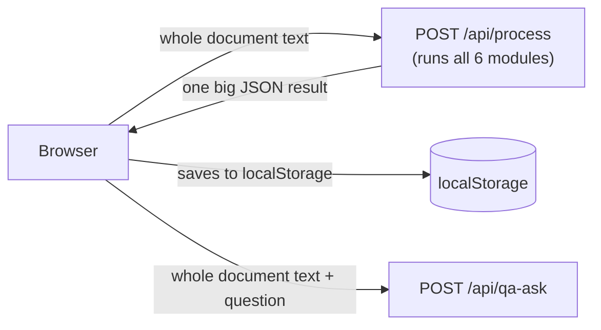
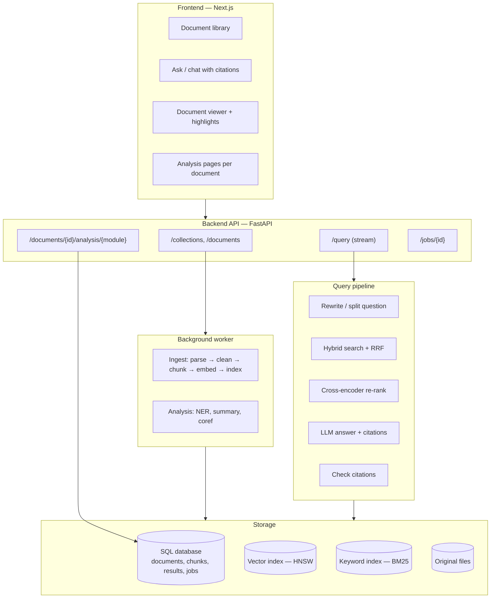
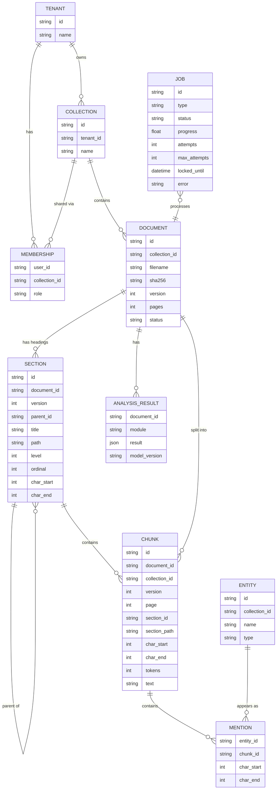
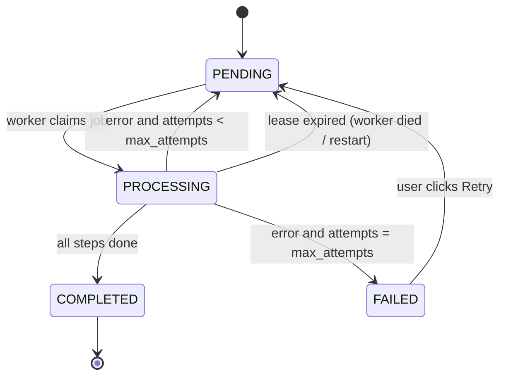
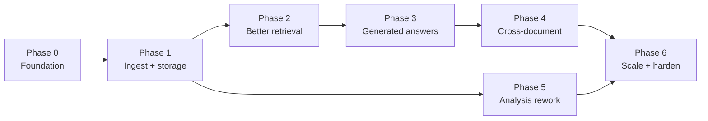

# CADIS V2 — Plan for Large and Multi-Document Intelligence

This report explains how to take CADIS from a single-document demo to a system that
can read **many large documents** and answer questions **across** them — including
questions that need simple reasoning, like adding two numbers that appear in the text.

The work is split into **seven phases** (Phase 0 to Phase 6). Each phase is useful on
its own, so you can stop after any phase and still have a better system than before.

---

## Contents

1. [Summary](#1-summary)
2. [Where CADIS is today](#2-where-cadis-is-today)
3. [What V2 should do](#3-what-v2-should-do)
4. [Key ideas, explained simply](#4-key-ideas-explained-simply)
5. [The new design](#5-the-new-design)
6. [The phases](#6-the-phases)
7. [How to measure progress](#7-how-to-measure-progress)
8. [Model choices](#8-model-choices)
9. [Decisions you need to make](#9-decisions-you-need-to-make)
10. [Risks and how to handle them](#10-risks-and-how-to-handle-them)

---

## 1. Summary

**Today**, CADIS takes the text of one document, runs six NLP modules on it in a single
request, and keeps the result in the browser. It works well for documents of a few
thousand words. It does not remember documents, cannot search across documents, and
its QA model can only copy a piece of text — it cannot reason or combine facts.

**V2** turns CADIS into a proper retrieval system:

- Documents are **uploaded once, processed in the background, and stored**.
- Text is cut into **chunks** that are stored in a **vector index** (HNSW, via ChromaDB
  or similar) and a **keyword index** (BM25).
- A question searches **all documents the user is allowed to see**, the best chunks are
  **re-ranked** by a cross-encoder, and an **answer generator** (an LLM) writes the answer
  as a list of **claims, each with citations** pointing to the exact source text.
- Every claim is checked twice: **does the quote exist** in the source, and **does the
  quote actually support the claim**.
- **Arithmetic is never done by the LLM.** The LLM decides *what* to calculate; Python
  does the calculation.
- Every document belongs to a **collection**, and every search is filtered by the
  collections the user may access — built in from the first version, not added later.
- The current extractive QA model stays, but its job changes: it becomes a way to find
  and highlight the exact supporting text.
- The single file `api_server.py` is split into a small package with clear parts.

**The most important design change** is moving from *"send the whole document with every
request"* to *"store documents once, then query them by ID"*. Almost every other
improvement depends on this.

---

## 2. Where CADIS is today

### 2.1 How it works now



- Everything lives in **one file**, `api_server.py` (~800 lines): model loading, the six
  modules, file parsing and the HTTP endpoints.
- The server is **stateless**. It does not save documents. The browser sends the full
  text again with every request.
- `/api/process` runs **all six modules in one blocking request**. Nothing is shown to the
  user until everything is finished.

### 2.2 Limits you already know about

| Limit | Why it happens |
|---|---|
| One document at a time | There is no document store, no document IDs, no collections. |
| Best for ~2,000–4,000 words | Every module runs on every request; time and response size grow with length. |
| No reasoning ("2 pens + 3 pens = ?") | RoBERTa-SQuAD2 only picks a **start** and **end** position in the text. It can only copy. It can never write "5". |
| No cross-passage answers | The answer must be one continuous span inside one window. Facts in two places cannot be joined. |
| No cross-document answers | Only one document exists at a time. |
| Ambiguity module does not do what you expected | See [Phase 5](#phase-5--rework-the-analysis-modules). In short: it is a rule of thumb, not a resolver. |
| No re-ranker | The top passages are chosen by MiniLM cosine similarity only. |
| No index (LSH / HNSW) | Retrieval compares the question with every passage (brute force), and passages are re-embedded on every question. |

### 2.3 Extra problems found while writing this report

These were measured on the current code (November 2026):

| Problem | Evidence | Effect |
|---|---|---|
| **NER silently ignores the end of long documents.** The Hugging Face NER pipeline is called on the whole text with no chunking, so text past the model's 512-token limit is dropped. | On a 3,610-word test document, a person named in the first sentence was found; a person named in the last sentence was **not**. | Entities in the second half of any long document are missing. |
| **MiniLM reads at most 256 tokens.** | `max_seq_length = 256`; one 200-word passage is already ~244 tokens. | Passages with many numbers or rare words get their end cut off before embedding, so retrieval cannot "see" that text. |
| **The `/api/process` response grows much faster than the document.** The sentence similarity matrix has *n × n* entries and every token is listed. | Preprocessing + embeddings JSON: 0.10 MB at 520 words, 1.1 MB at 2,600 words, **14 MB at 10,400 words**. | Browsers usually allow about 5 MB in `localStorage`, so large documents break the frontend. |
| `/api/qa-ask` re-splits and re-embeds the whole document for every question. | `answer_question(...)` is called without cached passages. | Every custom question repeats work that could be done once. |
| The "2-D embedding plot" uses the first two raw vector dimensions. | `run_embeddings` uses `vec[0]`, `vec[1]`. | The plot does not show real similarity between sentences. |

These are cheap to fix and are part of **Phase 0**.

---

## 3. What V2 should do

1. **Many documents.** Upload many files into a *collection* and keep them.
2. **Large documents.** Hundreds of pages per document, with steady speed.
3. **Better search.** Find the right text even when wording differs (meaning-based search)
   *and* when exact names, codes or numbers matter (keyword search).
4. **Better ranking.** A second, more careful model re-orders the search results.
5. **Answers that reason.** Combine facts, do simple math, compare documents.
6. **Trustworthy answers.** Every answer shows its sources. If the documents do not
   contain the answer, the system says so.
7. **Responsive UI.** Long work runs in the background with progress updates.
8. **Measured quality.** A test set and numbers that show whether each change helped.

---

## 4. Key ideas, explained simply

### 4.1 RAG in one picture

RAG = **R**etrieval-**A**ugmented **G**eneration. First *find* the relevant text, then
*give* only that text to a model that writes the answer.


### 4.2 Chunks

A document is too long to give to a model in one piece, so we cut it into **chunks**
(for example 300–500 tokens each, with a small overlap). Each chunk remembers where it came
from: document, page, section heading and character position. That "where" is what makes
citations and highlighting possible.

### 4.3 Embeddings and vector search

An **embedding** turns text into a list of numbers so that texts with similar meaning get
similar numbers. To answer a question we embed the question and look for the chunks with
the closest vectors.

### 4.4 Brute force vs. LSH vs. HNSW

Finding the closest vectors can be done three ways:

| Method | How it works (simple version) | Good for |
|---|---|---|
| **Brute force** (CADIS today) | Compare the question with *every* chunk. Always exact. | Up to tens of thousands of chunks. With NumPy this still takes milliseconds. |
| **LSH** (Locality-Sensitive Hashing) | Put vectors into "buckets" with a hash so that similar vectors usually land in the same bucket. Only check the question's bucket. | Very large data where memory is tight. Usually **lower accuracy** than HNSW for the same speed. |
| **HNSW** (Hierarchical Navigable Small World graph) | Build a graph where each vector links to its neighbours, with "express lanes" on upper layers. Search walks the graph toward the question. | The standard choice today. Fast and very accurate. Used inside ChromaDB, Qdrant, pgvector, FAISS and others. |

**When does an index start to matter?** There is no fixed number. The point where HNSW
beats brute force depends on the embedding size, the hardware, how many queries run at
once, how the index is configured, how fast answers must be, and how much filtering is
applied. At CADIS's starting scale, brute-force cosine similarity is perfectly
reasonable. **Measure first** (latency and recall on your own data) instead of designing
for a million-document workload that does not exist yet.

**So each storage piece has its own job:**

| Piece | Job |
|---|---|
| **SQLite** (later Postgres) | Documents, chunks, metadata, analysis results, jobs, access rules |
| **ChromaDB** | Store vectors on disk and run similarity search, with metadata filters |
| **BM25 / SQLite FTS5** | Keyword search |
| **HNSW** | Approximate nearest-neighbour search as the collection grows |

ChromaDB builds an HNSW index by itself, so you get it "for free". But the reason to add
ChromaDB now is **persistent vector storage and filtered search**, not speed. LSH is
worth learning, but for CADIS it would usually give lower accuracy than HNSW for the
same speed.

### 4.5 Keyword search (BM25) and hybrid search

Embeddings are good at meaning but weak at exact things: invoice numbers, rare names,
product codes, "Section 12". **BM25** is classic keyword scoring and is good at exactly
those. **Hybrid search** runs both and merges the two ranked lists. A simple and strong way
to merge is **Reciprocal Rank Fusion (RRF)**: each chunk gets `1 / (60 + rank)` from each
list, and the scores are added.

### 4.6 Re-ranker (cross-encoder)

- A **bi-encoder** (MiniLM today) embeds the question and the chunk *separately*. It is
  fast, but it never "reads them together".
- A **cross-encoder** reads the question and the chunk *together* and outputs one
  relevance score. It is much more accurate, but too slow to run on every chunk.

So we use both: the fast search picks ~50 candidates, then the cross-encoder re-orders them
and we keep the top ~6–8.

### 4.7 Extractive vs. generative answers

| | Extractive (RoBERTa-SQuAD2, today) | Generative (an LLM, V2) |
|---|---|---|
| How | Picks a start and end position in the text | Writes new text, token by token |
| "2 pens + 3 pens = ?" | Cannot answer "5" | Can answer "5" |
| Join facts from two places | No | Yes |
| Risk of making things up | Very low — it can only copy | Real — needs citations and checks |
| Speed on CPU | Fast | Slow for local models; fast with a hosted API |

V2 keeps **both**. The LLM writes the answer. The extractive model (or simple text matching)
is used to find the exact sentence that supports each part of the answer, so the UI can
highlight it.

> Note: a BART model on its own would not fix this either. DistilBART in CADIS is trained
> for summarization, not question answering. The fix is an **instruction-tuned LLM** that is
> given the retrieved chunks and told to answer only from them.

### 4.8 Cross-passage and cross-document questions

| Question type | Example | How V2 handles it |
|---|---|---|
| Single fact | "When was the contract signed?" | Normal retrieval + answer |
| Simple reasoning | "How many pens in total?" | LLM reads both facts and adds them |
| Multi-hop | "Where was the CEO of the company that bought NeuralBase born?" | Split into sub-questions, search for each in turn |
| Comparison | "How do the payment terms differ between contract A and B?" | Search each document separately, then combine |
| Aggregation | "List every contract with a late-payment fee." | Run a small question over each document (map), then merge (reduce); later use stored extracted facts |
| Section-targeted | "Find the dataset information from Methodology and the experimental results from Experiments." | One sub-question per named section, each searched with a soft section filter ([4.9](#49-structure-aware-retrieval-the-section-tree)) |

### 4.9 Structure-aware retrieval (the section tree)

Documents are not flat. A paper has *Methodology* and *Experiments*; a contract has
*Payment Terms* and *Termination*. V2 keeps that structure as a **section tree**, much like
folders on a disk:

```
Paper.pdf
├── 1 Introduction
├── 3 Methodology
│   ├── 3.1 Model
│   └── 3.2 Dataset          ← chunks live here, path "3 Methodology > 3.2 Dataset"
└── 4 Experiments
    └── 4.2 Results
```

It is used in two ways:

1. **Clean chunks.** A chunk never crosses a heading, so one chunk is about one topic.
   A short section becomes one small chunk rather than being glued to the next one.
2. **A soft filter at search time.** When a question names a section, search runs once
   *inside* that section and once over everything, and the two result lists are merged
   (RRF). Chunks from the named section rank higher, but a chunk from elsewhere can still
   win — useful when the "dataset" details actually sit in *4.1 Experimental Setup*, or
   the paper calls the section *Methods*.

Why not walk the tree instead of using vector search? Two reasons:
- **Speed is not the problem.** At ~10,000 chunks, HNSW and even brute force answer in
  milliseconds. What the tree adds is *precision* on questions with several targeted
  parts, where otherwise one section crowds out the other.
- **A wrong folder is a dead end.** A hard tree walk can never recover from picking the
  wrong section, and most questions name no section at all. So hybrid search stays the
  engine, and the tree guides it. See DECISIONS ADR-028.

---

## 5. The new design

### 5.1 Big picture



### 5.2 Split `api_server.py` into a package

One file was fine for a demo. With storage, jobs, retrieval and an LLM, it becomes hard to
change one part without breaking another. Suggested layout:

```
backend/
├── main.py                  # creates the FastAPI app, adds routers and CORS
├── config.py                # all settings in one place (model IDs, sizes, paths), read from env
├── api/
│   ├── collections.py       # create / list collections
│   ├── documents.py         # upload, list, delete documents
│   ├── query.py             # ask questions (normal + streaming)
│   ├── analysis.py          # per-document module results
│   └── jobs.py              # job status / progress
├── ingest/
│   ├── parsers.py           # PDF, DOCX, TXT, HTML → text + page numbers + headings
│   ├── cleaning.py          # fix broken lines, headers/footers, hyphenation
│   └── chunking.py          # token-based, structure-aware chunks with metadata
├── index/
│   ├── vector_store.py      # wrapper around Chroma (or pgvector / Qdrant)
│   └── keyword_store.py     # BM25 (SQLite FTS5 or rank_bm25)
├── retrieval/
│   ├── hybrid.py            # dense + BM25 + RRF
│   ├── rerank.py            # cross-encoder
│   └── query_planner.py     # rewrite, split multi-hop questions, route by document
├── answer/
│   ├── generative.py        # LLM answer with citations
│   ├── extractive.py        # today's RoBERTa code (span finding / highlighting)
│   └── verify.py            # check that citations really support the answer
├── analysis/
│   ├── preprocessing.py
│   ├── embeddings_view.py   # PCA / UMAP for the plot
│   ├── ner.py               # chunked NER + entity index
│   ├── coref.py             # replaces the old ambiguity module
│   └── summary.py           # today's map-reduce, run once per document and stored
├── models/
│   └── registry.py          # lazy loading, one place to see what is in memory
├── storage/
│   ├── db.py                # SQLAlchemy / SQLModel setup
│   └── schema.py            # tables (see 5.3)
├── jobs/
│   └── worker.py            # background job runner
└── tests/
```

**Rule of thumb:** the API layer only receives requests and returns responses. It never
contains NLP logic. That makes every NLP part testable without HTTP.

### 5.3 Data model



- **Every row that holds document content carries a `collection_id`** (chunks and
  entities too, not only documents). That is what lets every search be filtered by what
  the user may see. See [5.6](#56-access-control-from-day-one).
- `CHUNK.id` is **deterministic**, for example `hash(document_id, version, chunk_index)`.
  The same chunk always gets the same ID, so re-running ingestion overwrites instead of
  duplicating. See [5.5](#55-background-jobs).
- `sha256` lets you skip re-processing a file that was already uploaded.
- `model_version` lets you know which results must be recomputed after a model change.
- `ENTITY` + `MENTION` give you a cross-document entity index ("every document that
  mentions Meridian Corporation").
- The vector index stores one vector per `CHUNK.id`, with `document_id`, `collection_id`,
  `page` and `section_id` / `section_path` as metadata so a search can be limited to some
  documents or boosted toward a section.
- `SECTION` is the document's heading tree ([4.9](#49-structure-aware-retrieval-the-section-tree)).
  `path` (`"3 Methodology > 3.2 Dataset"`) lets a filter match a section *and* everything
  under it with one prefix test.

### 5.4 New API

| Endpoint | Purpose |
|---|---|
| `POST /collections` · `GET /collections` | Create / list collections |
| `POST /collections/{id}/documents` | Upload one or more files. Returns job IDs immediately. |
| `GET /jobs/{id}` (or `GET /jobs/{id}/events` with Server-Sent Events) | Progress of ingest / analysis |
| `GET /documents/{id}` · `DELETE /documents/{id}` | Document info, delete document and its chunks |
| `GET /documents/{id}/analysis/{module}?page=…` | One module's result, paginated (no more 14 MB responses) |
| `POST /query` | `{ collection_ids, question, document_ids?, history? }` → structured answer (below) |
| `POST /query/stream` | Same, but streams claims as they are ready |

The answer is a list of **claims**, not one paragraph with citations scattered through
it. Each claim can then be checked on its own:

```json
{
  "answer_text": "Revenue was ₹50 crore in 2025 [1].",
  "claims": [
    {
      "text": "Revenue was ₹50 crore in 2025.",
      "citations": [
        {
          "document_id": "doc_7",
          "chunk_id": "chunk_123",
          "page": 4,
          "quote": "The company reported revenue of ₹50 crore in 2025.",
          "char_start": 1032,
          "char_end": 1083
        }
      ],
      "checks": { "quote_found": true, "supported": "entailed", "support_score": 0.94 },
      "calculation": null
    }
  ],
  "status": "answered"
}
```

`status` is one of `answered`, `partially_supported` (some claims failed checks) or
`not_in_documents`. `calculation` is filled when a claim's number came from the
calculator ([Phase 3](#phase-3--generated-answers-with-citations)).

Keep the old `/api/process` and `/api/qa-ask` working until the new frontend is finished,
then remove them.

### 5.5 Background jobs

Ingesting a 300-page PDF can take minutes. An HTTP request should never wait for that.

**The problem with a plain in-memory queue.** A user uploads 20 documents, the API
creates 20 jobs, and the server restarts. An in-memory queue is gone. The files are still
on disk, but the jobs are lost or stuck showing "processing" forever.

**So the database is the source of truth for jobs.** Each job is a row with a state:



How it works:

- **Claiming.** A worker takes a `PENDING` job by updating it to `PROCESSING` and setting
  `locked_until` (a *lease*, e.g. now + 10 minutes), in one atomic database update, so two
  workers can never take the same job.
- **Heartbeat.** While working, the worker keeps extending `locked_until` and updates
  `progress`.
- **Recovery after restart.** On startup (and every minute), any `PROCESSING` job whose
  lease has expired is moved back to `PENDING`. Nothing stays stuck.
- **Retries.** On error, increase `attempts` and save `error`. Retry until
  `max_attempts`, then mark `FAILED` and show the error in the UI.

**Idempotency: running a job twice must give the same result as running it once.**
Retries and recovery mean a job *will* sometimes run twice. To make that safe:

- Chunk IDs are deterministic (`hash(document_id, version, chunk_index)`).
- Writes are **upserts** (insert or replace by ID) in SQLite, in ChromaDB and in the BM25
  index, never plain inserts.
- Re-ingesting a document creates a new `version`. The new chunks are written first; the
  document points to the new version only when everything is written; then the old
  version's chunks and vectors are deleted. Searches filter on the current version.
- SQLite and ChromaDB are two separate stores and cannot share one transaction. That is
  why the order matters: write chunks to SQLite → upsert vectors to ChromaDB → update
  BM25 → mark the job `COMPLETED` **last**. If the worker dies halfway, the job is retried
  and the upserts simply overwrite what was already there.
- A small **consistency check** (a script or periodic job) compares chunk IDs in SQLite
  and ChromaDB and repairs any difference.

**Execution.** Start with an in-process worker (a thread or process pool) that reads jobs
from the table. Because the state lives in the database, you can later move execution to
**RQ or Celery with Redis** without changing the API or the job states.

### 5.6 Access control from day one

Even if V2 starts as a single-user app, the data and the retrieval code must be
**collection-aware from the first version**. Adding this later is risky: one missed
filter and one user's question retrieves another user's documents.

Rules:

- Every collection belongs to a **tenant** (one user or team). Every document, chunk,
  vector, BM25 entry and entity carries its `collection_id`.
- The retrieval interface **requires** the list of allowed collection IDs. There is no
  "search everything" default:
  `search(question, allowed_collection_ids, document_ids=None)`.
- The allowed list comes from the logged-in user's memberships on the server, never
  directly from the request body.
- **Every** retrieval path applies the filter: vector search, BM25, the entity index,
  document-summary routing, and any cache (cache keys include the collection IDs).
- In the single-user version there is one default tenant and one user. The code paths are
  still the same, so adding real accounts in Phase 6 only adds login, not new filtering.
- **Tests:** create two tenants with different documents and assert that no query, entity
  lookup or summary search for tenant A ever returns tenant B's content.

### 5.7 Frontend changes

- **Library page:** collections, upload many files, see status of each.
- **Ask page:** chat-style questions over a whole collection, with a filter to pick
  documents. Answers show numbered citations like `[1]`, `[2]`.
- **Viewer:** clicking a citation opens the document at the right page with the source
  text highlighted.
- **Analysis pages:** load one module for one document from the API, page by page.
- **Stop storing big results in `localStorage`.** Keep only small things there (like the
  last opened collection ID).

---

## 6. The phases

Effort sizes are rough: **S** = a few days, **M** = 1–2 weeks, **L** = 2–4 weeks of
part-time work.



Phase 5 can run in parallel with Phases 2–4.

---

### Phase 0 — Foundation

**Goal:** make the current code safe to change, without adding features. **Effort: S–M**

**Why first:** without tests and an evaluation set, you cannot tell whether V2 changes
help or hurt.

Tasks:

1. **Split `api_server.py`** into the package from [5.2](#52-split-api_serverpy-into-a-package).
   Move the code without changing behaviour.
2. **Add `config.py`.** Move all magic numbers (`QA_WINDOW`, `PASSAGE_WORDS`,
   `SUM_CHUNK_TOKENS`, …) and model IDs into one settings object.
3. **Add tests** (`pytest`): chunking covers every word, QA offsets match the text,
   summary chunks fit the model, endpoints return the right shape. Use small fake models
   or mark slow tests so they can be skipped.
4. **Build a first evaluation set** (see [section 7](#7-how-to-measure-progress)).
5. **Fix the problems from 2.3:**
   - Run NER chunk by chunk (with overlap), then shift entity offsets back.
   - Keep passages under MiniLM's 256 tokens (count tokens, not words) — or move to a
     512-token embedding model in Phase 2.
   - Cache passage embeddings so `/api/qa-ask` does not redo them.
   - Stop sending the full *n × n* similarity matrix; send only the top pairs (or a
     limited block).
   - Use PCA for the 2-D plot instead of the first two dimensions.
6. **Add CI** (GitHub Actions): run tests and the frontend build on every push.

**Done when:** tests pass in CI; the evaluation script prints a baseline score for
today's system; a long document's NER finds names on the last page.

---

### Phase 1 — Ingestion and storage

**Goal:** documents are uploaded once, processed in the background and kept.
**Effort: L**

Tasks:

1. **Database.** Start with **SQLite** (one file, no server) through SQLModel or
   SQLAlchemy. Create the tables from [5.3](#53-data-model). Moving to Postgres later is
   easy if you use an ORM.
2. **Better parsing.**
   - PDF: **PyMuPDF** is fast and gives page numbers and font sizes (useful for finding
     headings). **Docling** or **unstructured** are stronger for tables and complex
     layouts, but heavier.
   - Scanned PDFs: OCR with **Tesseract** (for example through `ocrmypdf`), only when a
     page has no text layer.
   - Keep page numbers for every piece of text.
3. **Cleaning.** Remove repeated headers/footers and page numbers, join words broken by
   hyphens at line ends, fix line breaks inside sentences.
4. **Chunking.**
   - Count in **tokens** of the embedding model, not words.
   - **Build the section tree first** ([4.9](#49-structure-aware-retrieval-the-section-tree)):
     headings from DOCX styles, PDF font size / bold / numbering (`3.2 Dataset`), and TXT
     title lines; store them in `SECTION`.
   - Respect structure: chunk *inside* each section and never cross a heading (overlap
     included); a short section becomes one small chunk. Prefer to cut at paragraph, then
     sentence. Text without headings falls back to paragraph and sentence cuts.
   - Store `section_id` and `section_path` on every chunk.
   - Size ~300–500 tokens with ~10–15% overlap.
   - **Small-to-big:** search with small chunks, but give the answer model the chunk plus
     its neighbours (stored `prev`/`next` links). Search stays precise, and the answer
     model gets enough context.
   - **Contextual header:** before embedding, add the document title and section heading
     to the chunk text (e.g. `"Master Service Agreement › Payment terms: …"`). This
     helps a lot when a chunk says "the Client" without naming who that is.
5. **Background jobs** as a database-backed state machine
   ([5.5](#55-background-jobs)): `PENDING → PROCESSING → COMPLETED / FAILED`, with
   leases, retries, recovery on startup and progress (parsing → chunking → embedding →
   indexing → analysis).
6. **Idempotent writes:** deterministic chunk IDs, upserts everywhere, document versions,
   job marked `COMPLETED` last.
7. **Access control in the data model** ([5.6](#56-access-control-from-day-one)): a
   default tenant, `collection_id` on every content row, and a retrieval interface that
   requires allowed collection IDs.
8. **New endpoints** for collections, documents and jobs ([5.4](#54-new-api)).
9. **Duplicate check** by file hash.

**Done when:**
- you can upload 20 PDFs of 100+ pages each, close the browser, come back, and they are
  all there with status "ready";
- if you kill the server in the middle of ingestion and start it again, the interrupted
  jobs finish on their own, with **no duplicate chunks or vectors** (check counts in
  SQLite and ChromaDB);
- deleting a document removes its chunks, vectors and BM25 entries;
- the two-tenant isolation test passes.

---

### Phase 2 — Better retrieval

**Goal:** find the right chunks across many documents. **Effort: M**

Tasks:

1. **Upgrade the embedding model.** MiniLM-L6 reads only 256 tokens. Good CPU-friendly
   options with 512 tokens: `BAAI/bge-small-en-v1.5` (384-d, about as fast as MiniLM) or
   `BAAI/bge-base-en-v1.5` (768-d, more accurate). Test on your evaluation set before
   choosing. Note that BGE models expect a short instruction prefix on *queries*.
2. **Persistent vector store.** Start with **ChromaDB** (embedded mode, stored on disk).
   Store `document_id`, `collection_id`, `version` and `page` as metadata so every search
   is filtered by allowed collections and the current version. Hide it behind
   `index/vector_store.py` so you can swap to **pgvector** or **Qdrant** later without
   touching other code. ChromaDB uses HNSW internally; leave its settings at the defaults
   until measurements show a problem.
   - Keep a **brute-force path** for testing: on your evaluation set, compare ChromaDB's
     results with an exact NumPy search. If they match closely, the approximate index is
     not costing you accuracy.
   - Only tune HNSW settings (or consider other index types) when the measured latency
     or recall on *your* data says you need to.
3. **Keyword index (BM25).** Easiest: **SQLite FTS5** (built into SQLite, has a `bm25()`
   ranking function), so no extra service is needed. Alternative: `rank_bm25` / `bm25s`
   in memory.
4. **Hybrid search + RRF.** Take the top ~50 from each index and merge with RRF
   ([4.5](#45-keyword-search-bm25-and-hybrid-search)).
5. **Cross-encoder re-ranker.** `cross-encoder/ms-marco-MiniLM-L-6-v2` (fast, small) or
   `BAAI/bge-reranker-base` (more accurate, slower). Re-rank the ~50 candidates, keep the
   top 6–8.
6. **Diversity.** Avoid returning 6 chunks from the same page that say the same thing
   (for example, Maximal Marginal Relevance, or a limit per document for broad questions).
7. **Section soft filter** ([4.9](#49-structure-aware-retrieval-the-section-tree),
   ADR-028). If a question names a section, resolve the name against the document's real
   section titles (fuzzy match + title embedding, so "Methods" ≈ "Methodology"), run hybrid
   search with and without a `section_path` prefix filter, and merge both with RRF. A small
   matched section can be passed whole to the answer model. No section named → plain
   hybrid search.
8. **Use the new retrieval in today's extractive QA** first. That way you can measure
   the gain from retrieval alone, before the LLM is added.

**Done when:** on the evaluation set, *recall@8* (the right chunk is in the top 8) is
clearly higher than the Phase 0 baseline, and a query over ~10,000 chunks returns in about
a second on the Space's CPU.

---

### Phase 3 — Generated answers with citations

**Goal:** answers that can reason, combine facts and do simple math, while staying tied
to the source text. **Effort: M–L**

Tasks:

1. **Choose an LLM** (see [section 9](#9-decisions-you-need-to-make)):
   - **Hosted API** (for example Claude: `claude-haiku-5-5` for speed and cost,
     `claude-sonnet-5-5` for harder reasoning). Fast and strong. Costs money per request,
     and document text is sent to the provider.
   - **Local model** on CPU (for example a 1.5B–3B instruction model such as
     Qwen2.5-Instruct, quantized to 4-bit and run with `llama.cpp`). Free and private, but
     slow on a free CPU Space (expect several seconds to tens of seconds per answer) and
     weaker at reasoning.
   - Put the choice behind one interface (`answer/generative.py`) so you can switch.
2. **Ask for structured claims, not a paragraph.** Give the model the top chunks with
   their chunk IDs and ask for JSON in the shape shown in [5.4](#54-new-api): a list of
   claims, each with its citations and an exact supporting quote. Rules in the prompt:
   - Use only the sources. If the answer is not there, return `not_in_documents`.
   - One fact per claim, so each claim can be checked on its own.
   - Never compute numbers yourself — request a calculation instead (task 4).
   - Validate the JSON against a schema (e.g. Pydantic). If it is invalid, ask once more,
     then fall back to extractive mode.
3. **Verify every claim with two separate checks** (`answer/verify.py`):

   **Check 1 — Quote validation: does the quote really exist in the cited chunk?**
   Normalise whitespace and quote marks, then look for the quote in the chunk text.
   Allow tiny differences (fuzzy match), but no new words. If found, store its exact
   character position for highlighting.

   **Check 2 — Claim validation: does the quote actually support the claim?**
   Check 1 alone is not enough. Example: the document says *"The company reported
   revenue of ₹50 crore in 2025."* The model writes *"Revenue increased by 20% in 2025
   [1]"* and gives the ₹50 crore sentence as its quote. The quote exists, so Check 1
   passes — but nothing in it says "20%". So:
   - Run an **entailment (NLI) model** with the quote as the *premise* and the claim as
     the *hypothesis*. It answers *entailed*, *neutral* or *contradicted*.
     CPU-friendly start: `cross-encoder/nli-deberta-v3-base` (or a smaller variant).
   - Add a cheap rule on top: **every number, date and amount in the claim must appear
     in a cited quote or come from the calculator**. "20%" appears nowhere, so the claim
     fails even before the NLI model runs.
   - For claims that combine several quotes, run the check against all of that claim's
     quotes together.
   - Optionally, for important use cases, a second LLM call can act as an independent
     "evidence checker". It is slower and costs more.

   **What to do with the results:** claims that pass both checks are shown normally.
   Claims that fail are removed or shown as "not supported by the documents", and the
   answer's `status` becomes `partially_supported`. The checks are **a quality filter,
   not a guarantee** — NLI models also make mistakes, so the UI should always let the
   user open the source and read it.
4. **Rule: the LLM never does arithmetic. Python does.** This is an architectural rule,
   not a suggestion. Example — Document A: *"125 units sold."* Document B: *"275 units
   sold."* Question: *"How many units were sold altogether?"*
   1. **Retrieve** both facts (two chunks, two documents).
   2. **Extract** the numbers as structured values, each tied to its quote:
      `{ "name": "a", "value": 125, "unit": "units", "chunk_id": "…", "quote": "125 units sold" }`.
      Check that each value really appears in its quote.
   3. **The LLM picks the operation only**, as an expression over the named values:
      `"a + b"`.
   4. **A deterministic calculator** in Python computes it. It only accepts numbers,
      `+ - * /`, brackets and a few named functions (sum, average, percent change, min,
      max), parsed safely with Python's `ast` module. Never use `eval()` on model output.
      Use `Decimal` for money so rounding is exact.
   5. **Return** the result with citations for **both** inputs and the calculation shown:
      `125 + 275 = 400 units [A] [B]`. The claim's `calculation` field stores the
      expression, the inputs and the result.

   Also check units before calculating: do not add "units" to "boxes", and convert
   "₹50 crore" and "₹5 lakh" to the same unit first. If units do not match and cannot be
   converted, do not calculate — say so.
5. **Stream the answer** to the UI (`/query/stream`, Server-Sent Events), claim by claim,
   each one after its checks finish.
6. **Keep extractive mode** as an option ("exact quote only") for users who want zero
   generation.
7. **Update the README.** The current README says QA "cannot hallucinate". That stays true
   only for extractive mode. Explain the citation checks for generative mode.

**Done when:**
- numeric questions (like the pens example) are answered correctly, and **every number
  in an answer comes from a quote or from the calculator** — never from the LLM alone;
- cross-passage questions are answered correctly most of the time;
- unanswerable questions return `not_in_documents`;
- every shown claim passes both checks (quote found + supported);
- a set of deliberately wrong "trap" claims (like the 20% example) is caught by Check 2.

---

### Phase 4 — Cross-document and multi-hop questions

**Goal:** questions that need several documents or several steps. **Effort: L**

Tasks:

1. **Collection-wide search** is already there after Phase 2. Add a **document filter** in
   the UI and API.
2. **Query rewriting with chat history.** "What about the second contract?" must become a
   full question before searching. The LLM rewrites the question using the last few
   turns.
3. **Query planning** (`retrieval/query_planner.py`). The LLM decides the question type
   ([4.8](#48-cross-passage-and-cross-document-questions)):
   - *Multi-hop:* split into sub-questions; answer the first; use its answer in the
     next search ("iterative retrieval").
   - *Comparison:* run retrieval separately for each named document, then answer with
     both sets of sources.
   - *Aggregation:* run a small extraction over each document (map), then merge (reduce).
     Limit how many documents this touches, and show progress.
   - *Section-targeted:* split into one sub-question per named section, e.g.
     `[{q: "dataset information", section: "Methodology"}, {q: "experimental results",
     section: "Experiments"}]`. Each sub-question uses the Phase 2 soft section filter and
     gets its own share of the final chunks, so one section cannot crowd out the other.
4. **Document summaries as a routing layer.** At ingest, store a short summary per
   document (Phase 5 produces it). For broad questions ("Which documents talk about
   data privacy?"), first search the summaries to pick documents, then search chunks
   inside those documents.
5. **Entity index for "who/what" across documents.** Use the `ENTITY`/`MENTION` tables
   ("show everything about Meridian Corporation" → all chunks that mention it).
6. **Optional, later: knowledge graph (GraphRAG-style).** Extract
   (subject, relation, object) facts into a graph to answer relationship questions. This
   is powerful but costly to build; only do it if the evaluation set shows that Phases
   2–4 are not enough.

**Done when:** multi-hop and comparison questions in the evaluation set pass at an agreed
level, and answers cite more than one document when they should.

---

### Phase 5 — Rework the analysis modules

**Goal:** the six modules work on large documents and become useful for retrieval, not
just for display. **Effort: M** (can run alongside Phases 2–4)

1. **Run once, store, serve by page.** Each module runs as a background job after ingest
   and saves its result in `ANALYSIS_RESULT`. Pages load from the API, not
   `localStorage`.
2. **Preprocessing.** Keep stats for the whole document; return token details only for
   the page or section being viewed.
3. **Embeddings view.** Use PCA (or UMAP) to make a real 2-D map; show top similar pairs
   only; allow switching the view to "chunks across the collection".
4. **NER.**
   - Run chunk by chunk (fixes the truncation bug for good).
   - Keep entity **positions** so entities can be highlighted and linked.
   - Separate spaCy's `MONEY`, `CARDINAL` and `PERCENT` into their own groups (today they
     are all under "Money").
   - Merge different spellings of the same entity ("Tim Cook", "Cook") into one entity —
     this fills the cross-document entity index.
5. **Ambiguity → Coreference.** Why the current module does not work as expected:
   - *PP attachment:* it flags the first preposition that has any noun or verb within 5
     words. Almost every sentence has one, so it flags almost everything.
   - *"Resolution":* it compares the embedding of the *whole sentence* with the embedding
     of *single candidate words* and picks the closest one. That measures "which word is
     most like the sentence", not "which word the pronoun refers to".
   - It reports at most one item per sentence, and "resolved" always equals "detected".

   **Replace it with a real coreference model**, for example `fastcoref` (fast, works on
   CPU) or `maverick-coref` (more accurate). It returns groups of mentions that refer to
   the same thing ("Sarah Johnson … the CFO … she"). This is useful in two places:
   - **Display:** show each group, and highlight all mentions when one is clicked.
   - **Retrieval:** before chunking, add the resolved name next to pronouns in a copy of
     the text used only for embedding ("she [Sarah Johnson] stated…"). Chunks that only
     say "she" can then be found by searching for the name.

   If you want to keep PP-attachment as a teaching feature, label it clearly as a
   heuristic demo, and only flag cases where the parser gives two plausible heads.
6. **Summary.** Keep the current map-reduce (it now covers the whole document), but run it
   at ingest and store it. Build it in layers: summary per section, then per document,
   then (on request) per collection. If an LLM is available from Phase 3, it can write
   better summaries with long inputs; DistilBART can stay as the free fallback.

**Done when:** every module works on a 200-page document without timeouts or huge
responses, and the coreference view shows correct groups on the sample documents.

---

### Phase 6 — Scale, deploy and harden

**Goal:** run reliably for real users. **Effort: M**

1. **Persistence on Hugging Face Spaces.** A Space's disk is normally **wiped on
   restart**. Your SQLite file and Chroma index would disappear. Options (check current
   HF docs and prices):
   - paid persistent storage for the Space;
   - an external database: Postgres with **pgvector** (e.g. Supabase or Neon, which have
     free tiers) — this one service can replace both SQLite and Chroma;
   - a hosted vector database (e.g. Qdrant Cloud free tier) plus a hosted Postgres.
2. **Speed on CPU.**
   - Export embedding, re-ranker and NER models to **ONNX** and use int8 quantization
     (`optimum`). This often gives a 2–3× speed-up on CPU.
   - Embed in batches; cache embeddings by text hash.
   - Load models lazily, and check total memory: the current models plus a re-ranker,
     coreference model and (if local) an LLM must fit in the Space's RAM.
3. **Limits and safety.**
   - Maximum upload size and page count; reject files that are not really PDF/DOCX.
   - Rate limiting per IP or per user.
   - **Accounts and login** if more than one person will use it. The filtering itself
     already exists since Phase 1 ([5.6](#56-access-control-from-day-one)); this step
     adds real users, sharing of collections (memberships and roles), and authentication.
   - **Prompt injection:** a document can contain text like "ignore your instructions".
     Keep the rules in the system prompt, wrap document text clearly as data, and never
     let document text trigger actions.
4. **Monitoring.** Log each query's timings (search, re-rank, generation), the chunk IDs
   used, and errors. This makes bad answers easy to debug.
5. **Docs.** Update the README and architecture diagram for V2, including honest
   benchmark numbers.

**Done when:** the deployed app keeps documents across restarts, handles several users at
the same time, and has a dashboard or log you can read to see slow or failed queries.

---

## 7. How to measure progress

Without numbers, it is easy to add features that make answers *worse*. Build this in
Phase 0 and run it after every phase.

### 7.1 Your own evaluation set

Put 5–10 real documents in `data/eval/` and write 40–60 questions with:
the expected answer, the document(s) and the chunk/page that contain it.

Include all question types, in roughly equal numbers:

| Type | Example |
|---|---|
| Single fact | "What is the monthly retainer?" |
| Numeric reasoning | "How many pens are there in total?" |
| Cross-passage | facts in two paragraphs of one document |
| Cross-document | facts in two different documents |
| Comparison | "Which contract has the longer notice period?" |
| Unanswerable | a question the documents do not answer |
| Section-targeted | "From *Storage*, what is Harlow Ridge's capacity, and from *Extreme Weather*, what was the peak demand?" |

### 7.2 Public datasets (for extra checks)

| Dataset | What it tests |
|---|---|
| **SQuAD 2.0** | Extractive QA, including "no answer" questions (today's model was trained on it) |
| **DROP** | Reading + discrete reasoning: counting, adding, comparing numbers (your pens example) |
| **HotpotQA** | Multi-hop questions that need two paragraphs |
| **MultiHop-RAG** | Multi-hop questions across many news documents |

Use small samples (e.g. 200 questions) to keep runs short on CPU.

### 7.3 Metrics

| Part | Metric | Meaning |
|---|---|---|
| Retrieval | **Recall@k** | Is the right chunk in the top *k*? |
| Retrieval | **MRR** | How high is the first right chunk? |
| Answer (extractive) | **Exact Match / F1** | Same text as the expected answer? |
| Answer (generative) | **Correctness** | Judged by an LLM against the expected answer, spot-checked by you |
| Answer (generative) | **Faithfulness** | Is every claim supported by the cited text? (RAGAS has ready metrics) |
| Answer | **Abstention** | Does it say "not in the documents" for unanswerable questions? |
| System | **Latency p50 / p95** | Typical and slow-case response time |

Write one script, `eval.py`, that prints all of these in a table, and save each phase's
result so you can show the improvement in the README.

---

## 8. Model choices

All are CPU-friendly unless noted. Test on your evaluation set before you decide.

| Job | Today | V2 suggestion | Why |
|---|---|---|---|
| Embeddings | `all-MiniLM-L6-v2` (256 tokens) | `BAAI/bge-small-en-v1.5` or `bge-base-en-v1.5` (512 tokens) | Longer input, better retrieval scores |
| Re-ranker | none | `cross-encoder/ms-marco-MiniLM-L-6-v2` → `BAAI/bge-reranker-base` if accuracy matters more | Reads question + chunk together |
| Answer writer | none (extractive only) | Hosted LLM (e.g. Claude Haiku / Sonnet) **or** local 1.5B–3B instruct model via `llama.cpp` | Reasoning, math, combining facts |
| Span highlighting | `deepset/roberta-base-squad2` | keep | Finds exact supporting text |
| Claim checking | none | NLI cross-encoder, e.g. `cross-encoder/nli-deberta-v3-base` | Checks that a quote supports a claim |
| Arithmetic | none | Python calculator (`ast`-based, `Decimal`) — not a model | Exact, testable results |
| NER | `dslim/bert-base-NER` (truncates) | same model, run per chunk; optionally GLiNER for custom entity types | Fixes truncation; custom types like "contract clause" |
| Coreference | none (heuristic "ambiguity") | `fastcoref` or `maverick-coref` | Real pronoun / mention resolution |
| Summary | `distilbart-cnn-12-6` | keep as free fallback; LLM if available | Better long summaries |
| PDF parsing | `pypdf` | PyMuPDF; Docling for tables; Tesseract OCR for scans | Pages, headings, tables, scanned files |

---

## 9. Decisions you need to make

These choices change the design, so decide them before the phase that needs them.

| Decision | Options | Suggestion |
|---|---|---|
| **LLM: hosted or local?** (Phase 3) | Hosted API: fast, strong, costs money, sends text out. Local: free, private, slow on free CPU. | Hosted for quality and a smooth demo; keep a local option behind the same interface. |
| **Where data lives** (Phase 1 / 6) | SQLite + Chroma on disk (simple, lost on Space restart) · Postgres + pgvector (one service for everything) · Postgres + Qdrant | Start with SQLite + Chroma locally; move to Postgres + pgvector for deployment. |
| **When to add login?** (Phase 6) | Single user for now · real accounts | Collection-level filtering is built in from Phase 1 either way. Add login before anyone else uploads private documents. |
| **How big is "large"?** | Hundreds of pages per document · thousands of documents | Measure latency and recall at your real size before tuning the index; it also sets how much a hosted DB costs. |
| **Keep the six-module demo pages?** | Keep · simplify · merge into a document view | Keep them, but load per document from the API; they are a good teaching feature. |

---

## 10. Risks and how to handle them

| Risk | What could happen | How to handle it |
|---|---|---|
| LLM makes things up | Wrong answers that look right | Structured claims, quote check **and** entailment check, "not in the documents" rule, extractive mode |
| Real quote, wrong claim | A citation looks valid but does not support the claim | Separate claim validation (NLI + "every number must appear in a quote" rule) |
| LLM arithmetic errors | Wrong totals or percentages | LLM picks the operation; Python calculator computes; unit check first |
| Server restart during ingestion | Lost or stuck jobs, half-written data | Database job states with leases and recovery; idempotent upserts; `COMPLETED` written last |
| Data leak between users | One user's question retrieves another user's documents | `collection_id` everywhere from Phase 1, required filter in retrieval, isolation tests |
| Slow on free CPU | Timeouts, bad demo | Background jobs, streaming, ONNX, hosted LLM, smaller re-rank candidate list |
| Memory limit on the Space | Container crashes when many models load | Load models lazily, share one embedding model, measure RAM per model |
| Data loss on restart | Users lose documents | External database or persistent storage (Phase 6) |
| Bad PDFs | Broken text, missing tables, scanned pages | PyMuPDF + OCR fallback; show parse warnings in the UI |
| Prompt injection inside documents | Model follows instructions hidden in a file | Treat document text as data, strong system prompt, no automatic actions |
| Scope grows too fast | Nothing gets finished | Finish each phase with its "done when" check before starting the next |

---

### Suggested first steps

1. Phase 0, task 1–3: split the file, add config and tests (no behaviour change).
2. Phase 0, task 4: write the first 40 evaluation questions — including the pens example
   and a few cross-document ones that **fail today**. These are your targets.
3. Phase 0, task 5: fix NER truncation and the response-size problem.
4. Decide the two big questions in [section 9](#9-decisions-you-need-to-make): hosted vs.
   local LLM, and where the data will live. Then start Phase 1.
