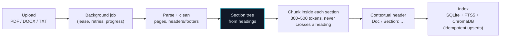
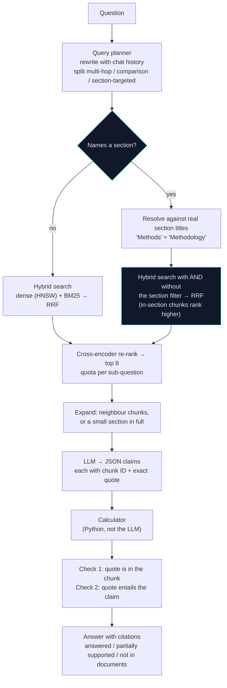
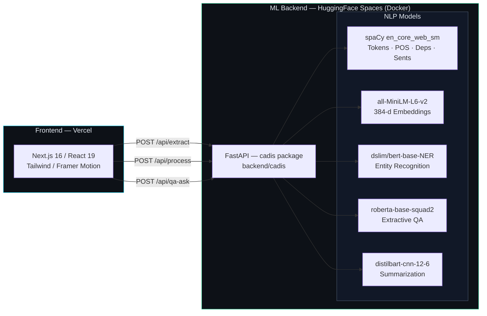

# CADIS — Context-Aware Document Intelligence System


A document intelligence platform that runs a six-module NLP pipeline over any PDF, DOCX or
pasted text — preprocessing, sentence embeddings, named entity recognition, ambiguity
resolution, extractive question answering and abstractive summarization — and walks you
through each stage in an interactive Next.js dashboard.

> **CADIS V2 is in progress.** V2 turns CADIS from a single-document demo into a system
> that stores **many large documents** and answers questions **across** them, with cited,
> checked answers. Phases 0–2 are done: documents are uploaded into collections and
> processed in the background (see the [Library](#try-the-v2-library-phase-1)), and
> questions are answered across a whole collection with hybrid search, re-ranking and
> section-aware retrieval (`POST /query`, extractive answers with a citation for now).
> LLM-written answers with checks come in Phase 3; the six-module analysis app is still V1. Jump to [CADIS V2](#cadis-v2--many-documents-cited-answers) for the design
> and roadmap.

---

## CADIS V2 — many documents, cited answers

### What changes

| | V1 (today) | V2 (target) |
|---|---|---|
| Documents | Sent with every request, never stored | Uploaded once into **collections**, stored and processed in background jobs |
| Scope | One document at a time | Questions across a whole collection |
| Chunks | Fixed-size passages that ignore headings | **Section-aware chunks**: never cross a heading, each knows its section path |
| Search | Brute-force MiniLM cosine | **Hybrid**: dense vectors (ChromaDB/HNSW) + BM25 (SQLite FTS5), fused with RRF, re-ranked by a cross-encoder, with a **soft section filter** |
| Answers | Extractive span (RoBERTa) | **Structured claims** written by an LLM, each with a citation and an exact quote, checked twice (quote match + entailment) |
| Arithmetic | Not possible | The LLM writes the expression; **Python computes it** (Decimal, unit checks) |
| Storage | None | SQLite (metadata, chunks, jobs, FTS5) + ChromaDB (vectors) + file store |

### How a document is ingested



Documents keep their structure as a **section tree**, like folders on a disk:

```
Paper.pdf
├── 3 Methodology
│   └── 3.2 Dataset        ← chunks here carry section_path "3 Methodology > 3.2 Dataset"
└── 4 Experiments
    └── 4.2 Results
```

Because a chunk never spans two sections, one chunk is about one topic.

### How a question is answered



**Why the section filter is soft.** For *"Find the dataset information from Methodology and
the experimental results from Experiments"*, the planner makes two sub-questions, one per
section, and each gets its own share of the final chunks so one section cannot crowd out
the other. Search still runs over everything too, so if the dataset details actually sit
in *Experimental Setup*, they are not lost. Questions that name no section use plain
hybrid search. HNSW stays the search engine; the tree guides it
([ADR-028](DECISIONS.md#adr-028--section-tree-as-a-soft-retrieval-filter)).

### Roadmap

| Phase | Goal | Status |
|---|---|---|
| 0 — Foundation | Package split, config, tests, evaluation set, CI, V1 scale fixes | ✅ Done |
| 1 — Ingestion and storage | Stored collections, background jobs, section tree, section-aware chunking, tenancy, Library page | ✅ Done |
| 2 — Better retrieval | ChromaDB + BM25 hybrid, cross-encoder re-ranker, section soft filter, `/search` + `/query` | ✅ Done |
| 3 — Generated answers | LLM claims with citations, two checks, Python calculator | Next |
| 4 — Cross-document | Query planner: multi-hop, comparison, section-targeted sub-questions | Planned |
| 5 — Analysis rework | Stored per-document results, coreference, entity index | Planned |
| 6 — Scale and deploy | Persistent storage, ONNX on CPU, auth, limits, monitoring | Planned |

### Try the V2 Library (Phase 1)

Start the backend and frontend as in [Getting Started](#getting-started), then open
[http://localhost:3000/library](http://localhost:3000/library):

1. Create a collection and drop in PDF, DOCX or TXT files (several at once).
2. The upload returns immediately; each file becomes a background job. Status and
   progress update live (parsing → finding sections → saving → embedding → indexing),
   and ingestion keeps going if you close the page.
3. Expand a document to see the **section tree** that was found, with chunk counts.
4. Re-ingest (creates a new version), retry a failed job, or delete a document; deleting
   removes its chunks, vectors and keyword-index entries.

The same through the API:

```bash
curl -X POST localhost:8000/collections -H "Content-Type: application/json" -d '{"name":"Contracts"}'
curl -X POST localhost:8000/collections/<collection_id>/documents -F files=@a.pdf -F files=@b.docx   # 202
curl -N localhost:8000/jobs/<job_id>/events          # live progress (Server-Sent Events)
curl localhost:8000/documents/<document_id>/sections # the section tree

# Phase 2: ask across everything you may see (or narrow with "collection_ids")
curl -X POST localhost:8000/search -H "Content-Type: application/json" \
     -d '{"question": "From the Payment section, what interest applies to late payment?"}'
curl -X POST localhost:8000/query  -H "Content-Type: application/json" \
     -d '{"question": "How much energy can the Harlow Ridge battery store?"}'
```

Measured on a CPU laptop: 20 PDFs × 105 pages uploaded in one request were all ready
after 73 s (2,683 chunks). A server killed in the middle of ingestion finished the
interrupted job by itself after a restart, with no duplicate chunks or vectors.

Data is stored under `CADIS_DATA_DIR` (default `./var`): `cadis.db` (SQLite with the FTS5
keyword index), `chroma/` (vectors) and `files/` (original uploads). On HF Spaces this is
`/tmp/cadis-data`, which is **wiped on restart** until persistent storage is chosen
([ADR-020](DECISIONS.md#adr-020--production-storage)).

### Measuring progress

Every phase is measured on the same evaluation set in `data/eval/`: 8 documents and 70
questions, 10 each of single-fact, numeric, cross-passage, cross-document, comparison,
unanswerable and (since Phase 2) section-targeted. Results are in `data/eval/results/`.

| Metric | Phase 0 (V1) | Phase 2 | Phase 2, 18,765 chunks |
|---|---|---|---|
| Recall@3 / @6 / @8 (all evidence in top k) | 0.74 / 0.94 / – | **0.95 / 0.98 / 1.00** | 0.95 / 0.98 / 0.98 |
| MRR (first right chunk) | 0.86 | **0.98** | 0.98 |
| Exact match: single-fact / cross-passage | 0.90 / 0.70 | 0.80 / 0.70 | 0.80 / 0.70 |
| Exact match: numeric / cross-document / comparison | 0.00 / 0.20 / 0.20 | 0.00 / 0.30 / 0.10 | 0.00 / 0.30 / 0.10 |
| Unanswerable questions correctly declined | 0.70 | 0.60 | 0.50 |
| Retrieval latency, 2 CPU threads (≈ HF Space) | – | – | median 0.8 s |

The "18,765 chunks" column adds 732 Wikipedia articles (WikiText-2) as distractors.
Phase 0 searched only 28 passages, so its recall is flattered; Phase 2 finds the evidence
almost always, even among 670× more text. Answers barely moved because the **extractive
model is now the limit**: the evidence is in its context 98–100 % of the time, but it can
only copy one span — it cannot add numbers, compare or say "not in the documents"
reliably. That is Phase 3's job.

**V2 documents:** [`CADIS V2.md`](CADIS%20V2.md) (phase plan and the ideas behind it) ·
[`ARCHITECTURE_V2.md`](ARCHITECTURE_V2.md) (components, data model, flows) ·
[`DECISIONS.md`](DECISIONS.md) (why each choice was made) ·
[`CHECKLIST.md`](CHECKLIST.md) (task progress) ·
[`COMMIT_HISTORY.md`](COMMIT_HISTORY.md) (what changed when).

---

## Current release (V1)

The rest of this README describes the V1 analysis app (six modules over one document),
which still runs next to the new V2 API.

## Architecture



There is no separate API gateway — the frontend calls FastAPI directly, with CORS
restricted to localhost plus the origins in `CADIS_FRONTEND_URLS` (or the V1 `FRONTEND_URL`).

### Request Flow

1. **Upload** — the user drops a `.pdf` / `.docx` / `.txt` file (or pastes text, or picks
   a bundled sample) on `/launch`
2. **Extract** — `POST /api/extract` parses `.pdf` / `.docx` files with `pypdf` /
   `python-docx` and returns plain text (`.txt` files are read directly in the browser)
3. **Process** — `POST /api/process` runs all six modules in one call and returns a single
   JSON payload
4. **Explore** — the result is cached in `localStorage` and rendered across six pages under
   `/pipeline/*`, one per module
5. **Ask** — on the QA page, `POST /api/qa-ask` answers arbitrary follow-up questions
   against the same document

---

## The Six Modules

| # | Module | Model | What it produces |
|---|--------|-------|------------------|
| 1 | **Preprocessing** | spaCy `en_core_web_sm` | Tokens with lemma/POS/dependency, sentence split, corpus stats |
| 2 | **Embeddings** | `all-MiniLM-L6-v2` | 384-d sentence vectors, similarity matrix for the first 20 sentences, most-similar pairs across all sentences, PCA 2-D map |
| 3 | **NER + IE** | `dslim/bert-base-NER` + spaCy | Person/Org/Location/Misc entities (BERT, run in sentence-aligned windows so long documents are read to the end) plus Date and numeric entities (spaCy — the "Money" bucket also holds cardinals and percentages), subject-verb-object relations |
| 4 | **Ambiguity** | MiniLM + spaCy parse | PP-attachment and anaphoric ambiguities (at most one per sentence), each with a resolved candidate |
| 5 | **QA Engine** | `deepset/roberta-base-squad2` | Extractive answer spans with character offsets and confidence |
| 6 | **Summary** | `sshleifer/distilbart-cnn-12-6` | Abstractive executive summary, key sentences, date-anchored timeline |

### How QA works

Extractive QA returns a span of your document — it never generates text, so it cannot
hallucinate. Getting a *correct* span requires more than an argmax:

- The document is split into overlapping passages of at most 220 **embedding-model
  tokens** (50-token overlap), so each passage fits inside MiniLM's 256-token limit and
  nothing is cut off before embedding. MiniLM ranks them against the question and the
  top 6 go to the model. Long documents stay answerable without running the QA model over
  every window. Passage vectors are **cached per document** (a small LRU shared by
  `/api/process` and `/api/qa-ask`), so follow-up questions only embed the question.
  (Retrieval is a no-op for short documents that split into at most 6 passages anyway.)
- Retrieved passages that are adjacent in the document are **merged into contiguous blocks
  before tokenization**. A lone passage never overflows a 384-token window, so feeding
  passages individually meant the stride did nothing. Once adjacent passages are merged,
  the block tiles into multiple windows at a 128-token stride, so an answer
  straddling a passage seam is recoverable. Retrieved passages that are *not* adjacent
  stay separate single-window blocks — there is no seam between them to straddle.
- Candidate spans are restricted to *context* tokens, must satisfy `end >= start`, and are
  capped at 40 tokens.
- SQuAD2 models emit a no-answer score at the `[CLS]` position. A span is only returned if
  it outscores that null; otherwise the answer is empty. Confidence is the sigmoid of that
  margin.
- Answers are sliced from the original text by character offset, so casing and punctuation
  are preserved and the frontend can highlight the exact source region. Offsets are
  relative to the text as sent, including any leading whitespace.

### How summarization works

DistilBART accepts 1024 tokens (roughly 750 words) and silently truncates anything longer,
so every input it sees is sized to fit. Documents up to 400 words are summarized in one
pass. Longer documents are split into evenly-sized, sentence-aligned chunks of ~512
tokens (sentences with no punctuation, common in PDF extraction, are broken into word
windows). Every sentence goes into exactly one chunk, so the whole document is covered.
Each chunk is summarized, near-duplicate sentences are dropped, and the partials are
condensed into the executive summary — recursively, if the partials themselves exceed
1024 tokens. There is no cap on the number of chunks, so summarization time grows
linearly with document length (a 6,000-word document takes ~50 s on a CPU laptop).

---

## Performance

All five model loaders (in `backend/cadis/models/registry.py`) are wrapped in
`@lru_cache(maxsize=1)`, so weights load once per worker process and are reused.
`backend/scripts/benchmark.py` measures what that buys:

```
python backend/scripts/benchmark.py
```

One run on a CPU-only Windows laptop with weights already in `~/.cache/huggingface`
(`python benchmark.py 100 400`, measured before the Phase 0 refactor):

| Document | Warm request (inference) | Cold request (load + inference) | Ratio |
|---|---|---|---|
| 100 words | 3.3 s | 38.8 s | **11.8×** |
| 400 words | 11.3 s | 46.8 s | **4.2×** |

Absolute numbers vary a lot between machines and runs (the figures previously quoted
here were 7.9 s / 16.8 s warm with ~23 s load), so treat them as illustrative. Two things to
know about the method:

- The *cold* column is computed, not measured: it is the one-time load cost plus the warm
  inference time. That load cost (35.5 s in the run above) includes importing
  torch/transformers as well as loading weights from disk.
- Load is paid exactly once per worker; afterwards all five `lru_cache` lookups together
  take tens of microseconds.

What holds across runs is the shape: the cold/warm ratio is **highest on short documents**,
where load dominates, and falls as inference grows — it is a property of the document,
not a single headline number.

A true cold start *in deployment* is larger than any of these, because the Dockerfile
deliberately does not pre-download weights (it blew past the HF Spaces build timeout), so
the first request after a container wake also pays a ~2.1 GB network download. That cost
is bandwidth-dependent and not reproducible as a fixed figure, which is why it is not
quoted here.

---

## Getting Started

### Prerequisites

- Python 3.11+
- Node.js 20.9+ (required by Next.js 16)

### 1. ML Backend

```bash
python -m venv .venv
source .venv/bin/activate    # Windows: .venv\Scripts\activate
pip install -r requirements.txt
python -m spacy download en_core_web_sm
uvicorn cadis.main:app --app-dir backend --host 0.0.0.0 --port 8000 --reload
```

(`uvicorn api_server:app` from the repository root still works; `api_server.py` is a
compatibility shim during the V2 migration.)

Models download from HuggingFace on first use (~2.1 GB total, most of it DistilBART) and are cached afterwards.

### 2. Frontend

```bash
cd client
npm install
npm run dev
```

Open [http://localhost:3000](http://localhost:3000).

### 3. Tests and evaluation

```bash
pip install -r requirements-dev.txt            # pytest + httpx, on top of requirements.txt
pytest backend                                 # unit + integration tests, fake models (~20 s)
pytest backend -m slow                         # real models (downloads ~2 GB on first run)
python backend/scripts/eval.py                 # retrieval + answer quality on data/eval
python backend/scripts/eval.py --save phaseN   # also write data/eval/results/phaseN.json
python backend/scripts/check_consistency.py    # SQLite vs ChromaDB vs FTS5 (--repair to fix)
python backend/scripts/eval.py --distractors 732 --data-dir var/eval-big   # + 732 Wikipedia articles (~18,800 chunks)
python backend/scripts/bench_retrieval.py --data-dir var/eval-big --threads 2   # latency ≈ HF Space, HNSW vs exact
```

Integration tests (`backend/tests/integration/`) use a real SQLite and ChromaDB in a temp
folder: they crash ingestion at several points and check that recovery leaves no
duplicates, and that two tenants never see each other's documents. Tests never write to
`./var`.

CI (`.github/workflows/ci.yml`) runs the unit tests, `npx tsc --noEmit` and
`npm run build` on every push to `main`.

### Environment Variables

Backend settings live in `backend/cadis/config.py` and are read from environment
variables with a `CADIS_` prefix (a `.env` file works in development). The V1 names in
brackets are still accepted.

| Variable | Service | Purpose |
|----------|---------|---------|
| `NEXT_PUBLIC_API_URL` | Frontend | FastAPI base URL (default `http://localhost:8000`) |
| `CADIS_FRONTEND_URLS` (`FRONTEND_URL`) | Backend | Comma-separated frontend origins added to the CORS allow-list |
| `CADIS_QA_MODEL` (`QA_MODEL`) | Backend | QA model (default `deepset/roberta-base-squad2`) |
| `CADIS_SUM_MODEL` (`SUM_MODEL`) | Backend | Summarization model |
| `CADIS_NER_MODEL` (`NER_MODEL`) | Backend | NER model |
| `CADIS_EMB_MODEL` (`EMB_MODEL`) | Backend | Embedding model |
| `CADIS_DATA_DIR` | Backend | V2 storage folder: SQLite, ChromaDB, uploads (default `./var`) |
| `CADIS_DATABASE_URL` | Backend | Override the database (default SQLite in the data dir) |
| `CADIS_MAX_UPLOAD_MB` | Backend | Upload size limit per file (default 25) |
| `CADIS_CHUNK_TOKENS` / `CADIS_CHUNK_OVERLAP` | Backend | Chunk size and overlap in embedding tokens (default 200 / 24) |
| `CADIS_RUN_WORKER` | Backend | Start the background job worker with the app (default `true`) |
| `CADIS_RERANK_MODEL` / `CADIS_USE_RERANKER` / `CADIS_RERANK_CANDIDATES` | Backend | Cross-encoder re-ranker (default `ms-marco-MiniLM-L-6-v2`, on, 20 candidates) |
| `CADIS_SECTION_FILTER` | Backend | Use section names in questions as a soft filter (default `true`) |

Tuning values (passage size, QA window, NER window, summary chunk size, job leases, …)
are listed in `config.py`, each overridable the same way.

---

## API

| Endpoint | Method | Body | Returns |
|----------|--------|------|---------|
| `/health` | GET | — | Service status |
| `/api/extract` | POST | `multipart/form-data` file | `{ text, chars, words }` |
| `/api/process` | POST | `{ text }` | All six module results |
| `/api/qa-ask` | POST | `{ text, question }` | `{ question, answer, confidence, start, end }` |
| **V2** `/collections` | POST · GET | `{ name }` | Create / list collections |
| `/collections/{id}/documents` | POST · GET | multipart `files` (several) | `202` + `[{ document_id, job_id, duplicate }]` · documents with status |
| `/documents/{id}` | GET · DELETE | — | Document info with latest job · delete everything derived from it |
| `/documents/{id}/sections` | GET | — | Section tree of the current version |
| `/documents/{id}/reingest` | POST | — | `202` + new job (new version) |
| `/jobs/{id}` · `/jobs/{id}/events` | GET | — | Job state · live progress (SSE) |
| `/jobs/{id}/retry` | POST | — | Re-queue a failed job |
| `/search` | POST | `{ question, collection_ids?, document_ids?, k? }` | Ranked chunks with sections, scores, recognised section names, timings |
| `/query` | POST | `{ question, collection_ids?, document_ids? }` | `{ status, answer_text, claims: [{ text, citations }] }` (extractive for now) |

V2 errors use `{ "detail": … }` with real status codes. Full design:
[`ARCHITECTURE_V2.md` §9](ARCHITECTURE_V2.md#9-api).

---

## Project Structure

```
CADIS/
├── backend/
│   ├── cadis/              # FastAPI backend package
│   │   ├── main.py         # app factory: routers, CORS, startup (migrations, worker)
│   │   ├── config.py       # all settings (pydantic-settings)
│   │   ├── api/            # V2 collections / documents / jobs, health, V1 endpoints (legacy.py)
│   │   ├── analysis/       # the six modules: preprocessing, embeddings view, NER, ambiguity, summary
│   │   ├── answer/         # extractive QA (RoBERTa span decoding, passage cache)
│   │   ├── ingest/         # parse → clean → section tree → chunks; ingest job, upload service
│   │   ├── index/          # VectorStore (ChromaDB) and FTS5 keyword search
│   │   ├── retrieval/      # hybrid search, RRF, re-rank, section filter, small-to-big expansion
│   │   ├── jobs/           # database-backed job queue and worker
│   │   ├── storage/        # SQLAlchemy tables, repositories, file store
│   │   └── models/         # registry.py — the only place models are loaded
│   ├── migrations/         # Alembic (run automatically at startup)
│   ├── tests/              # unit/ (fakes), integration/ (real SQLite + ChromaDB), slow/ (real models)
│   ├── scripts/            # benchmark.py, eval.py, check_consistency.py
│   └── pyproject.toml      # pytest configuration
├── api_server.py           # compatibility shim: from cadis.main import app
├── Dockerfile              # HuggingFace Spaces image (CPU torch; models fetched on first use)
├── requirements.txt        # Python dependencies (requirements-dev.txt adds test tools)
├── hf_README.md            # HF Space card metadata
├── .github/workflows/      # CI
├── client/                 # Next.js 16 frontend
│   ├── app/
│   │   ├── page.tsx        # Landing page
│   │   ├── launch/         # Upload / paste / sample + pipeline runner (V1)
│   │   ├── library/        # V2: collections, uploads, ingest progress, section trees
│   │   └── pipeline/       # One page per module
│   ├── components/         # Landing sections + shadcn/ui primitives
│   └── lib/                # api.ts (typed V2 client), utils.ts (cn)
└── data/
    ├── ambiguity_dataset.csv
    └── eval/               # evaluation documents, questions and saved results
```

---

## License

This project is for academic and research purposes.
