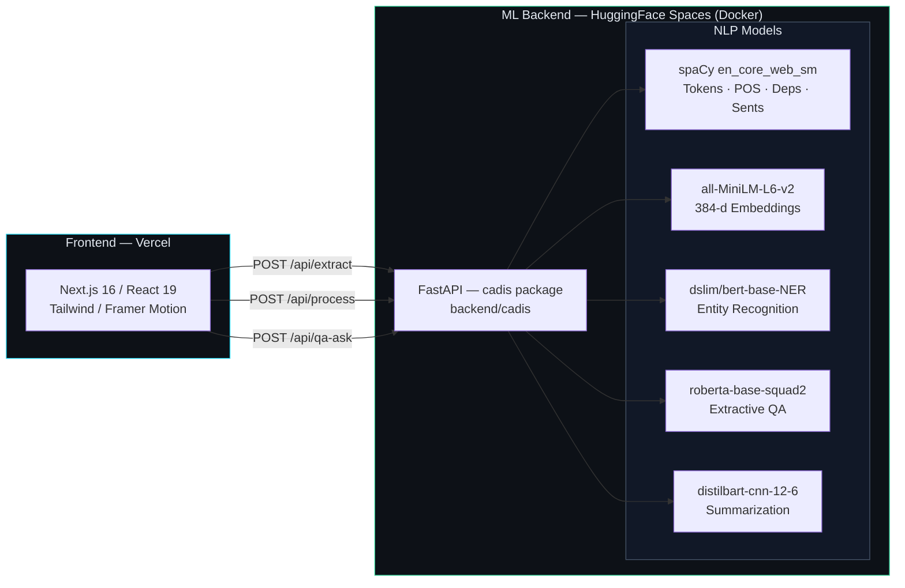

# CADIS — Context-Aware Document Intelligence System


A document intelligence platform that runs a six-module NLP pipeline over any PDF, DOCX or
pasted text — preprocessing, sentence embeddings, named entity recognition, ambiguity
resolution, extractive question answering and abstractive summarization — and walks you
through each stage in an interactive Next.js dashboard.

---

## Architecture



There is no separate API gateway — the frontend calls FastAPI directly, with CORS
restricted to localhost plus the origins in `CADIS_FRONTEND_URLS` (or the V1 `FRONTEND_URL`).

> **V2 in progress.** CADIS is being rebuilt for many large documents and cross-document
> questions. See [`CADIS V2.md`](CADIS%20V2.md) (phase plan), [`CHECKLIST.md`](CHECKLIST.md)
> (progress), [`ARCHITECTURE_V2.md`](ARCHITECTURE_V2.md) and [`DECISIONS.md`](DECISIONS.md).
> Phase 0 (package split, config, tests, evaluation, CI) is in place; the API is still V1.

### Request Flow

1. **Upload** — the user drops a `.pdf` / `.docx` / `.txt` file (or pastes text, or picks
   a bundled sample) on `/launch`
2. **Extract** — `POST /api/extract` parses `.pdf` / `.docx` files with `pypdf` /
   `python-docx` and returns plain text (`.txt` files are read directly in the browser)
3. **Process** — `POST /api/process` runs all six modules in one call and returns a single
   JSON payload
4. **Explore** — the result is cached in `localStorage` and rendered across six pages under
   `/pipeline/*`, one per module
5. **Ask** — on the QA page, `POST /api/qa-ask` answers arbitrary follow-up questions
   against the same document

---

## The Six Modules

| # | Module | Model | What it produces |
|---|--------|-------|------------------|
| 1 | **Preprocessing** | spaCy `en_core_web_sm` | Tokens with lemma/POS/dependency, sentence split, corpus stats |
| 2 | **Embeddings** | `all-MiniLM-L6-v2` | 384-d sentence vectors, similarity matrix for the first 20 sentences, most-similar pairs across all sentences, PCA 2-D map |
| 3 | **NER + IE** | `dslim/bert-base-NER` + spaCy | Person/Org/Location/Misc entities (BERT, run in sentence-aligned windows so long documents are read to the end) plus Date and numeric entities (spaCy — the "Money" bucket also holds cardinals and percentages), subject-verb-object relations |
| 4 | **Ambiguity** | MiniLM + spaCy parse | PP-attachment and anaphoric ambiguities (at most one per sentence), each with a resolved candidate |
| 5 | **QA Engine** | `deepset/roberta-base-squad2` | Extractive answer spans with character offsets and confidence |
| 6 | **Summary** | `sshleifer/distilbart-cnn-12-6` | Abstractive executive summary, key sentences, date-anchored timeline |

### How QA works

Extractive QA returns a span of your document — it never generates text, so it cannot
hallucinate. Getting a *correct* span requires more than an argmax:

- The document is split into overlapping passages of at most 220 **embedding-model
  tokens** (50-token overlap), so each passage fits inside MiniLM's 256-token limit and
  nothing is cut off before embedding. MiniLM ranks them against the question and the
  top 6 go to the model. Long documents stay answerable without running the QA model over
  every window. Passage vectors are **cached per document** (a small LRU shared by
  `/api/process` and `/api/qa-ask`), so follow-up questions only embed the question.
  (Retrieval is a no-op for short documents that split into at most 6 passages anyway.)
- Retrieved passages that are adjacent in the document are **merged into contiguous blocks
  before tokenization**. A lone passage never overflows a 384-token window, so feeding
  passages individually meant the stride did nothing. Once adjacent passages are merged,
  the block tiles into multiple windows at a 128-token stride, so an answer
  straddling a passage seam is recoverable. Retrieved passages that are *not* adjacent
  stay separate single-window blocks — there is no seam between them to straddle.
- Candidate spans are restricted to *context* tokens, must satisfy `end >= start`, and are
  capped at 40 tokens.
- SQuAD2 models emit a no-answer score at the `[CLS]` position. A span is only returned if
  it outscores that null; otherwise the answer is empty. Confidence is the sigmoid of that
  margin.
- Answers are sliced from the original text by character offset, so casing and punctuation
  are preserved and the frontend can highlight the exact source region. Offsets are
  relative to the text as sent, including any leading whitespace.

### How summarization works

DistilBART accepts 1024 tokens (roughly 750 words) and silently truncates anything longer,
so every input it sees is sized to fit. Documents up to 400 words are summarized in one
pass. Longer documents are split into evenly-sized, sentence-aligned chunks of ~512
tokens (sentences with no punctuation, common in PDF extraction, are broken into word
windows). Every sentence goes into exactly one chunk, so the whole document is covered.
Each chunk is summarized, near-duplicate sentences are dropped, and the partials are
condensed into the executive summary — recursively, if the partials themselves exceed
1024 tokens. There is no cap on the number of chunks, so summarization time grows
linearly with document length (a 6,000-word document takes ~50 s on a CPU laptop).

---

## Performance

All five model loaders (in `backend/cadis/models/registry.py`) are wrapped in
`@lru_cache(maxsize=1)`, so weights load once per worker process and are reused.
`backend/scripts/benchmark.py` measures what that buys:

```
python backend/scripts/benchmark.py
```

One run on a CPU-only Windows laptop with weights already in `~/.cache/huggingface`
(`python benchmark.py 100 400`, measured before the Phase 0 refactor):

| Document | Warm request (inference) | Cold request (load + inference) | Ratio |
|---|---|---|---|
| 100 words | 3.3 s | 38.8 s | **11.8×** |
| 400 words | 11.3 s | 46.8 s | **4.2×** |

Absolute numbers vary a lot between machines and runs (the figures previously quoted
here were 7.9 s / 16.8 s warm with ~23 s load), so treat them as illustrative. Two things to
know about the method:

- The *cold* column is computed, not measured: it is the one-time load cost plus the warm
  inference time. That load cost (35.5 s in the run above) includes importing
  torch/transformers as well as loading weights from disk.
- Load is paid exactly once per worker; afterwards all five `lru_cache` lookups together
  take tens of microseconds.

What holds across runs is the shape: the cold/warm ratio is **highest on short documents**,
where load dominates, and falls as inference grows — it is a property of the document,
not a single headline number.

A true cold start *in deployment* is larger than any of these, because the Dockerfile
deliberately does not pre-download weights (it blew past the HF Spaces build timeout), so
the first request after a container wake also pays a ~2.1 GB network download. That cost
is bandwidth-dependent and not reproducible as a fixed figure, which is why it is not
quoted here.

---

## Getting Started

### Prerequisites

- Python 3.11+
- Node.js 20.9+ (required by Next.js 16)

### 1. ML Backend

```bash
python -m venv .venv
source .venv/bin/activate    # Windows: .venv\Scripts\activate
pip install -r requirements.txt
python -m spacy download en_core_web_sm
uvicorn cadis.main:app --app-dir backend --host 0.0.0.0 --port 8000 --reload
```

(`uvicorn api_server:app` from the repository root still works; `api_server.py` is a
compatibility shim during the V2 migration.)

Models download from HuggingFace on first use (~2.1 GB total, most of it DistilBART) and are cached afterwards.

### 2. Frontend

```bash
cd client
npm install
npm run dev
```

Open [http://localhost:3000](http://localhost:3000).

### 3. Tests and evaluation

```bash
pip install -r requirements-dev.txt            # pytest + httpx, on top of requirements.txt
pytest backend                                 # unit tests with fake models (seconds)
pytest backend -m slow                         # real models (downloads ~2 GB on first run)
python backend/scripts/eval.py                 # retrieval + answer quality on data/eval
python backend/scripts/eval.py --save phaseN   # also write data/eval/results/phaseN.json
```

CI (`.github/workflows/ci.yml`) runs the unit tests, `npx tsc --noEmit` and
`npm run build` on every push to `main`.

### Environment Variables

Backend settings live in `backend/cadis/config.py` and are read from environment
variables with a `CADIS_` prefix (a `.env` file works in development). The V1 names in
brackets are still accepted.

| Variable | Service | Purpose |
|----------|---------|---------|
| `NEXT_PUBLIC_API_URL` | Frontend | FastAPI base URL (default `http://localhost:8000`) |
| `CADIS_FRONTEND_URLS` (`FRONTEND_URL`) | Backend | Comma-separated frontend origins added to the CORS allow-list |
| `CADIS_QA_MODEL` (`QA_MODEL`) | Backend | QA model (default `deepset/roberta-base-squad2`) |
| `CADIS_SUM_MODEL` (`SUM_MODEL`) | Backend | Summarization model |
| `CADIS_NER_MODEL` (`NER_MODEL`) | Backend | NER model |
| `CADIS_EMB_MODEL` (`EMB_MODEL`) | Backend | Embedding model |

Tuning values (passage size, QA window, NER window, summary chunk size, …) are listed in
`config.py`, each overridable the same way.

---

## API

| Endpoint | Method | Body | Returns |
|----------|--------|------|---------|
| `/health` | GET | — | Service status |
| `/api/extract` | POST | `multipart/form-data` file | `{ text, chars, words }` |
| `/api/process` | POST | `{ text }` | All six module results |
| `/api/qa-ask` | POST | `{ text, question }` | `{ question, answer, confidence, start, end }` |

---

## Project Structure

```
CADIS/
├── backend/
│   ├── cadis/              # FastAPI backend package
│   │   ├── main.py         # app factory: routers + CORS
│   │   ├── config.py       # all settings (pydantic-settings)
│   │   ├── api/            # health + V1 endpoints (legacy.py)
│   │   ├── analysis/       # the six modules: preprocessing, embeddings view, NER, ambiguity, summary
│   │   ├── answer/         # extractive QA (RoBERTa span decoding, passage cache)
│   │   ├── ingest/         # file parsers (PDF / DOCX / TXT)
│   │   └── models/         # registry.py — the only place models are loaded
│   ├── tests/              # unit/ (fake models) and slow/ (real models)
│   ├── scripts/            # benchmark.py, eval.py
│   └── pyproject.toml      # pytest configuration
├── api_server.py           # compatibility shim: from cadis.main import app
├── Dockerfile              # HuggingFace Spaces image (CPU torch; models fetched on first use)
├── requirements.txt        # Python dependencies (requirements-dev.txt adds test tools)
├── hf_README.md            # HF Space card metadata
├── .github/workflows/      # CI
├── client/                 # Next.js 16 frontend
│   ├── app/
│   │   ├── page.tsx        # Landing page
│   │   ├── launch/         # Upload / paste / sample + pipeline runner
│   │   └── pipeline/       # One page per module
│   ├── components/         # Landing sections + shadcn/ui primitives
│   └── lib/utils.ts        # Tailwind className helper (cn)
└── data/
    ├── ambiguity_dataset.csv
    └── eval/               # evaluation documents, questions and saved results
```

---

## License

This project is for academic and research purposes.
